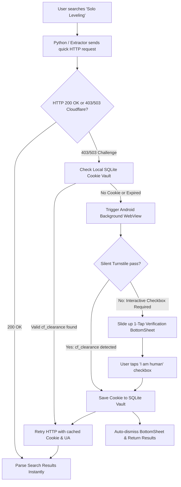

# Android In-App Search & Zero-Hassle Cloudflare Bypass Architecture

## 1. Executive Summary

This document outlines how **Manhua-extractor** can natively search and download from Cloudflare-protected manga/manhua platforms (such as **KunManga, ManhuaUS, MangaTX, Reaper Scans, ComicK, Asura Scans protected mirrors, and Webtoon aggregators**) directly inside an Android device **without** external servers, Docker containers, proxy fees, or desktop FlareSolverr setups.

---

## 2. Why Cloudflare Blocks Headless Searches & Why Android Has an Unfair Advantage

### The Problem on Headless Python (Desktop/Server)
When Python libraries (`aiohttp`, `requests`, `urllib`) ping Cloudflare Turnstile or Bot Fight Mode:
1. **TLS Fingerprint Mismatch**: Python's OpenSSL cipher suites and TLS extensions (JA3/JA4 fingerprints) immediately alert Cloudflare that the client is not a genuine web browser.
2. **Missing JavaScript Runtime**: Cloudflare injects cryptographic challenges (`challenges.cloudflare.com`, Turnstile tokens, Canvas/WebGL verification) which Python cannot execute without a headless browser.
3. **Heavy Desktop Workarounds**: On desktop, users must run Docker with FlareSolverr (requiring 1GB+ RAM, Chromium headless, xvfb) or paid proxy APIs. This is completely unacceptable on a battery-constrained mobile device.

### The Android Superpower: Authentic Native `WebView`
Every modern Android device has **Android System WebView** pre-installed and constantly updated via Google Play:
- **100% Authentic Chromium/Blink Engine**: It is the exact engine running Google Chrome for Android.
- **Genuine Mobile Hardware Fingerprints**: Passes WebGL, Canvas, AudioContext, Screen orientation, and touch sensor telemetry without spoofing.
- **Genuine Android TLS Stack**: Ciphers and TLS handshakes match Google Chrome perfectly.
- **Automatic Silent Clearance**: Over 90% of Cloudflare Turnstile challenges pass **completely silently** in a background Android WebView because Cloudflare verifies the genuine Chrome engine and mobile environment.

---

## 3. Proven Industry Precedent: How Tachiyomi / Mihon Does It

Tachiyomi (and its successor Mihon) solved this for millions of users with a two-tier interceptor:



---

## 4. The 4 Native In-App Mechanisms

### Mechanism 1: Native Android Cookie Vault & Chaquopy Bridge
When Cloudflare clears a browser, it issues two cookies:
- `cf_clearance` (valid for 24 to 72 hours per domain).
- `__cf_bm` (Cloudflare Bot Management token).

Android provides `android.webkit.CookieManager`:
```kotlin
val cookieManager = CookieManager.getInstance()
val cookieString = cookieManager.getCookie(domainUrl)
// e.g. "cf_clearance=b78a9c...; __cf_bm=49a0f..."
```

**Sync with Python**:
Kotlin exposes this via Chaquopy or an internal loopback API (`http://127.0.0.1:8000/api/cf-cookies`):
1. Python checks its local cache for `(domain, cf_clearance, expires_at)`.
2. When searching KunManga or ManhuaUS, Python passes:
   ```python
   headers = {
       "User-Agent": android_chrome_user_agent,
       "Cookie": cached_cookie_string
   }
   async with session.get(search_url, headers=headers) as resp:
       ...
   ```
3. Because the cookie is valid for up to 72 hours, **99% of subsequent searches and chapter downloads happen at full native HTTP speed without opening any browser engine!**

---

### Mechanism 2: Silent Background WebView Resolver
When a cookie is expired or missing:
1. Android instantiates a headless `WebView` in the background (offscreen or `View.GONE`).
2. It sets the authentic Chrome mobile User-Agent:
   ```kotlin
   webView.settings.userAgentString = WebSettings.getDefaultUserAgent(context)
   webView.settings.javaScriptEnabled = true
   webView.settings.domStorageEnabled = true
   ```
3. Load the target URL: `webView.loadUrl(protectedSearchUrl)`.
4. Monitor URL changes and cookies via `WebViewClient`:
   ```kotlin
   webView.webViewClient = object : WebViewClient() {
       override fun onPageFinished(view: WebView?, url: String?) {
           val cookies = CookieManager.getInstance().getCookie(url)
           if (cookies?.contains("cf_clearance") == true) {
               // SUCCESS! Cloudflare silently resolved!
               saveClearanceCookie(url, cookies)
               notifyPythonResolverSuccess(cookies)
               webView.destroy()
           }
       }
   }
   ```
5. **No user interaction is needed** in the vast majority of cases. The search simply finishes 1-2 seconds later.

---

### Mechanism 3: Direct Headless DOM Search Evaluator
For websites that heavily obfuscate their search results with client-side JavaScript (e.g. MangaDex search API limits or SPA sites):
1. The background WebView loads `https://kunmanga.com/?s=solo+leveling`.
2. Once the page DOM is loaded, Android runs:
   ```kotlin
   webView.evaluateJavascript("""
       (function() {
           var items = [];
           document.querySelectorAll('.c-tabs-item__content, .search-wrap .row').forEach(el => {
               var titleEl = el.querySelector('.post-title h3 a, h4 a');
               var imgEl = el.querySelector('img');
               var latestEl = el.querySelector('.latest-chap, .chapter');
               if (titleEl) {
                   items.push({
                       title: titleEl.innerText.trim(),
                       url: titleEl.href,
                       cover: imgEl ? (imgEl.getAttribute('data-src') || imgEl.src) : '',
                       latest_chapter: latestEl ? latestEl.innerText.trim() : ''
                   });
               }
           });
           return JSON.stringify(items);
       })();
   """.trimIndent()) { resultJson ->
       // Return structured JSON directly to search dispatcher!
   }
   ```
3. **Benefit**: Bypasses anti-scraping DOM transforms and obfuscated cookies completely because the browser engine itself evaluates and parses the page.

---

### Mechanism 4: Unobtrusive 1-Tap Verification Bottom Sheet (Fail-Safe)
If Cloudflare presents an aggressive "Verify you are human" checkbox that cannot be passed automatically:
1. The background WebView detects that the page contains `cf-turnstile` or title contains `"Just a moment..."` for > 3 seconds.
2. A sleek Android `BottomSheetDialog` slides up displaying the WebView:
   - **Header**: *"Verifying KunManga (One-time check)"*
   - **Body**: The interactive Cloudflare checkbox.
3. The user taps the checkbox once.
4. **Auto-Dismissal**: The instant the challenge completes, `onPageFinished` captures `cf_clearance`, **automatically dismisses the BottomSheet**, stores the cookie for 72 hours, and resumes the search. The user never has to press "Done", "Save", or "Continue".

---

## 5. Technical Implementation Blueprint

### 5.1 SQLite Cookie Vault Schema
Inside `library.db`:
```sql
CREATE TABLE IF NOT EXISTS cloudflare_clearance_cache (
    domain TEXT PRIMARY KEY,
    cookie_string TEXT NOT NULL,
    user_agent TEXT NOT NULL,
    created_at TIMESTAMP DEFAULT CURRENT_TIMESTAMP,
    expires_at TIMESTAMP NOT NULL
);
```

### 5.2 Python Extractor Integration Hook
Inside `core/search/dispatcher.py` or `extractors/`:
```python
async def fetch_with_cloudflare_fallback(url: str, domain: str) -> Optional[str]:
    # 1. Try normal aiohttp with cached cookie
    cookie = get_cached_cf_cookie(domain)
    headers = {"User-Agent": get_cached_user_agent(domain)}
    if cookie:
        headers["Cookie"] = cookie
        
    try:
        async with aiohttp.ClientSession() as session:
            async with session.get(url, headers=headers, timeout=8) as resp:
                if resp.status == 200:
                    html = await resp.text()
                    if "challenges.cloudflare.com" not in html and "Just a moment..." not in html:
                        return html
    except Exception:
        pass

    # 2. If running on Android (Chaquopy), trigger native Android CloudflareResolver
    if is_android_environment():
        from com.adityapatra.manhuaextractor import CloudflareResolverBridge
        fresh_cookie = await CloudflareResolverBridge.resolveDomain(domain, url)
        if fresh_cookie:
            headers["Cookie"] = fresh_cookie
            async with aiohttp.ClientSession() as session:
                async with session.get(url, headers=headers, timeout=8) as resp:
                    if resp.status == 200:
                        return await resp.text()
                        
    return None
```

### 5.3 Battery & Resource Guardrails
1. **Lazy Loading**: WebViews are only created when a Cloudflare 403/503 is encountered, not on every search.
2. **Aggressive Cleanup**: Once `cf_clearance` is extracted, `webView.stopLoading()`, `webView.destroy()`, and `System.gc()` are called immediately.
3. **No Continuous Background Daemons**: Unlike desktop FlareSolverr which runs 24/7 consuming 500MB+ RAM, the Android WebView is ephemeral (alive for 2 to 5 seconds only when a token expires).

---

## 6. Comparison: Android In-App vs. Other Solutions

| Feature | External FlareSolverr / Docker | Paid Scraping APIs | **Android Native WebView (Our Plan)** |
| :--- | :--- | :--- | :--- |
| **Server Requirement** | Yes (Desktop/VPS needed) | Yes (Cloud API needed) | **None (100% on-device)** |
| **Cost** | Free (self-hosted) | \$20–\$100 / month | **100% Free & Open Source** |
| **Mobile Portability** | Fails outside home Wi-Fi | Requires internet API key | **Works anywhere (LTE/5G/Wi-Fi)** |
| **Setup Hassle** | High (Docker, ports, IP sync) | Medium (API keys, quotas) | **Zero (Out of the box in .apk)** |
| **Token Caching** | Memory cache | Per-request billing | **SQLite Vault (Up to 72 Hours)** |
| **Human Checkbox Fallback**| Often fails or hangs | Solved by captchas | **Seamless 1-Tap Bottom Sheet** |

---

## 7. Immediate Next Steps & Rollout Plan

1. **Phase 1 (Now)**: Keep all 23 active, high-speed, direct-search platforms enabled (Asura, Arena, Flame, Vortex, Rolia, TopManhua, ManhuaPlus, MangaDex, WeebCentral, MangaPill, etc.).
2. **Phase 2 (Android Kotlin Bridge)**:
   - Add `CloudflareResolver.kt` inside `android/app/src/main/java/com/adityapatra/manhuaextractor/`.
   - Wire `CookieManager` listener and Chaquopy callback.
3. **Phase 3 (Enable Protected Sources)**:
   - Re-enable KunManga, ManhuaUS, MangaTX, and Reaper Scans inside the active search dispatcher using `fetch_with_cloudflare_fallback`.

