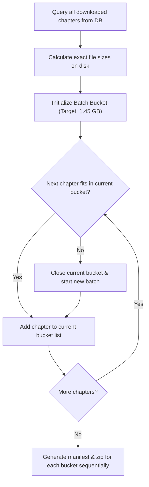
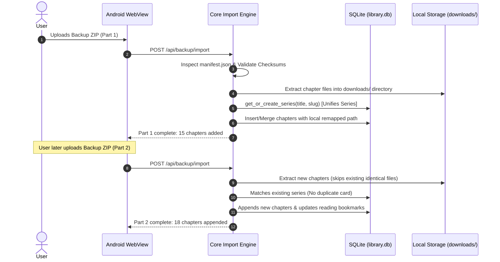

# Universal Manhua Extractor: Backup, Batch Export & Incremental Sync Architecture

A production-grade engineering and architectural specification detailing the design, database contracts, file formats, and execution pipelines for **1.5 GB Multi-Batch Backup Export** and **Fault-Tolerant Sequential Incremental Sync**.

---

## 1. System Goals & Requirements

1. **Self-Contained Multi-Volume Batches**:
   - Users can export either as a **Single Complete ZIP** or split into **~1.5 GB Batches** (`part01.zip`, `part02.zip`, etc.).
   - Prevents memory crashes on mobile devices and bypasses FAT32 (4 GB) and cloud upload ceilings (e.g., Telegram 2 GB, WhatsApp 2 GB, cloud storage transfer timeouts).
2. **Order-Independent Sequential Sync**:
   - A clean phone can import `Part 1`, then `Part 2`, then `Part 3` (or even in arbitrary order `Part 3` then `Part 1`).
   - Imports must **merge non-destructively**: no series cards or chapters from previous imports are overwritten or duplicated.
3. **Cross-Device Dynamic Path Re-Mapping**:
   - Absolute file paths on Phone A (e.g., `/data/user/0/com.manhua.extractor/files/downloads/...`) must never be hardcoded into restored databases.
   - The restore engine must dynamically rewrite all chapter and cover paths to match Phone B’s local environment.
4. **Zero-RAM Spike Streaming**:
   - Mobile Chaquopy environments run on constrained heap sizes (often 512 MB). Compression and decompression must use chunked stream buffers (64 KB chunks), avoiding in-memory byte loading of large archives.

---

## 2. Backup Archive Structure & Manifest Specification

Each generated backup ZIP (whether standalone or a batch part) follows a deterministic structure:

```
manhua_backup_part01.zip
├── manifest.json                  # Metadata, batch index, checksums, series mappings
├── database_dump.json             # Portable database export for series & chapters in this batch
└── files/                         # Chapter archives and cover images
    ├── Solo_Leveling/
    │   ├── cover.jpg
    │   ├── Solo_Leveling_Ch_01.cbz
    │   └── Solo_Leveling_Ch_02.cbz
    └── Ultra_Alter/
        ├── cover.jpg
        └── Ultra_Alter_Ch_01.pdf
```

### Manifest Schema (`manifest.json`)
```json
{
  "format_version": "1.0",
  "app_version": "1.0.4",
  "created_at": "2026-10-11T12:00:00Z",
  "export_id": "exp_a1b2c3d4",
  "batch": {
    "is_batched": true,
    "batch_index": 1,
    "total_batches": 3,
    "batch_label": "Part 1 of 3"
  },
  "stats": {
    "series_count": 2,
    "chapter_count": 15,
    "uncompressed_bytes": 1542189020
  },
  "series": [
    {
      "slug": "ultra-alter",
      "title": "Ultra Alter",
      "alt_titles": "Ultra-Alternate Character",
      "author": "JIXKSEE",
      "status": "Completed",
      "engine": "roliascan",
      "cover_relative_path": "files/Ultra_Alter/cover.jpg",
      "chapters": [
        {
          "chapter_num": 1.0,
          "chapter_slug": "chapter-1",
          "title": "Chapter 1",
          "relative_path": "files/Ultra_Alter/Ultra_Alter_Ch_01.pdf",
          "file_format": "pdf",
          "file_size": 24512000,
          "panel_count": 45,
          "read_status": 1,
          "last_read_page": 12
        }
      ]
    }
  ]
}
```

---

## 3. The 1.5 GB Batching Engine (Bin-Packing Algorithm)

To guarantee that each `.zip` stays under the ~1.5 GB limit without corrupting or splitting individual chapter files:



### Algorithmic Safeguards:
1. **Target Soft Ceiling**: Use **1.45 GB (1,484 MB)** as the batch limit. This accounts for ZIP headers, manifest JSON, cover images, and compression dictionary overhead, ensuring the final archive never exceeds 1.5 GB.
2. **Single Large File Exception**: If a single compiled CBZ/PDF chapter is larger than 1.45 GB (rare high-res compilation), it is allocated its own dedicated single-chapter batch without failing the job.
3. **Sequential Disk Streaming**: Instead of holding multi-gigabyte data in RAM, `zipfile.ZipFile(path, 'w', compression=zipfile.ZIP_DEFLATED)` writes directly to disk in 64 KB buffered chunks.

---

## 4. The Sequential Incremental Import & Sync Pipeline

When a user imports multiple backup zips (e.g. Part 1, then Part 2, then Part 3):



### Conflict Resolution & Merge Rules

| Data Element | Incoming State | Existing State on Phone | Final Merged State |
|---|---|---|---|
| **Series Record** | Title: "Ultra Alter" | Title: "Ultra Alter" | **Preserve & Update**: Matches via `lower(trim(title))` and updates missing metadata (cover, author). |
| **New Chapter** | Chapter 15 (file exists in zip) | Not in database | **Inserted**: Extracted to disk, chapter row created, path set to Phone B's download dir. |
| **Existing Chapter** | Chapter 1 (in zip) | Chapter 1 already on Phone | **Non-Destructive**: Keeps local file if already valid; avoids re-extracting bytes. |
| **Reading Progress** | Read Page: 25, Status: Read | Read Page: 0, Status: Unread | **Max Wins**: Highest reading progress and completion status is retained. |
| **Storage Paths** | Phone A `/data/user/0/...` | Phone B `/storage/emulated/0/...` | **Remapped**: Replaced with `os.path.join(DOWNLOADS_DIR, safe_title, filename)`. |

---

## 5. API Contracts

### 1. Pre-Flight Export Estimation
- **Endpoint**: `GET /api/backup/estimate`
- **Response**:
```json
{
  "total_series": 4,
  "total_chapters": 82,
  "total_size_bytes": 4820194816,
  "total_size_formatted": "4.49 GB",
  "batches_1_5gb": 3
}
```

### 2. Trigger Export Job
- **Endpoint**: `POST /api/backup/export`
- **Request Body**:
```json
{
  "mode": "batched",          // "single" or "batched"
  "batch_size_mb": 1450,       // Target batch ceiling
  "include_files": true        // true = full offline, false = metadata only
}
```
- **Response**:
```json
{
  "success": true,
  "job_id": "bkp_20261011_01",
  "total_batches": 3,
  "batch_files": [
    "/api/backup/download/bkp_20261011_01_part1.zip",
    "/api/backup/download/bkp_20261011_01_part2.zip",
    "/api/backup/download/bkp_20261011_01_part3.zip"
  ]
}
```

### 3. Restore / Sync Backup
- **Endpoint**: `POST /api/backup/import`
- **Form Data**: `file` (Multipart `.zip` upload)
- **Response**:
```json
{
  "success": true,
  "batch_info": "Part 1 of 3",
  "series_synced": 2,
  "chapters_imported": 28,
  "chapters_skipped_duplicate": 0,
  "storage_freed_or_used": "+620 MB"
}
```

---

## 6. Edge Cases, Flaw Analysis & Defensive Architecture

| Potential Flaw / Risk | Root Cause | Production Defensive Measure |
|---|---|---|
| **Zip-Slip Path Traversal** | Malicious or malformed ZIP containing `../../` filenames. | **Strict Boundary Enforcement**: Every extracted file path is validated with `os.path.commonpath([dest_dir, target_file]) == dest_dir`. Traversal attempts abort immediately. |
| **ZIP64 Overflow Crash** | Single archive exceeding 4 GB or 65,535 files raises `LargeZipFile`. | **Mandatory ZIP64**: `zipfile.ZipFile(..., allowZip64=True)` is enforced on all export operations. |
| **Folder/Raw Image Chapters** | Chapter stored as a folder (`file_format == 'folder'`) rather than a single file. | **Recursive Folder Traversal**: Bin-packing calculates total directory size via `sum(os.path.getsize(f))`; archiver recursively adds all panels inside `files/<Series>/<Ch_Folder>/`. |
| **Missing Covers in Partial Batches** | Part 2 imported on clean phone before Part 1; series created with no cover. | **Self-Contained Series Assets**: Every batch that includes chapters for a series bundles that series' cover image (`cover.jpg`), guaranteeing full asset self-sufficiency in any import order. |
| **RAM Spikes & Android `/tmp` Failures** | Buffering 1.5 GB multipart uploads in memory crashes Chaquopy / Android. | **Direct-to-Disk Streamer**: Imports stream chunks (64 KB) directly to `.staging_backup/` in the app's writable private directory, bypassing `/tmp` and consuming < 15 MB RAM. |
| **Database Locked on Export** | Active background downloader or cron scheduler writes to `library.db` during export. | **Read-Only Transaction Snapshot**: Export queries read directly within `BEGIN DEFERRED` read transactions and write to `database_dump.json`, preventing lock collisions. |
| **Unicode & CJK Character Corruption** | Manga titles with Korean, Japanese, Chinese, or accents corrupted in ZIP headers. | **UTF-8 Zip Flag Enforcement**: Filenames encoded explicitly as UTF-8 in `ZipInfo` structures with system illegal characters (`[\\/*?:"<>|]`) sanitized for disk paths. |
| **Storage Exhaustion from Temp Exports** | Exported batches accumulate on phone storage. | **Auto-Purge Lifecycle**: Exported archives are registered with an expiry timestamp (24h) and a manual "Clear Export Cache" button in Settings. |

---

## 7. Implementation Checklist for Clean Integration

- [ ] **Step 1: Core Backup Engine (`core/backup_engine.py`)**:
  - `calculate_chapter_size(chapter_record)` (handles single file & directory chapters).
  - `estimate_backup_batches(target_size_bytes=1450*1024*1024)` (bin-packing algorithm).
  - `create_backup_batch(batch_index, target_chapters, output_zip_path)` (ZIP64 streaming, UTF-8 manifest, self-contained covers).
  - `inspect_backup_archive(zip_path)` (validates format, manifests, Zip-Slip safety).
  - `restore_backup_archive(zip_path, merge_strategy="smart_sync")` (safe staging, path remapping, non-destructive DB sync).
- [ ] **Step 2: Unit Test Suite (`tests/test_backup_and_sync.py`)**:
  - Test batch estimation & 1.5 GB bin-packing logic.
  - Test single-archive vs multi-batch creation.
  - Test out-of-order restoration (Part 2 then Part 1) and series unification.
  - Test Zip-Slip detection & rejection.
  - Test reading progress bookmark preservation.
- [ ] **Step 3: FastAPI Endpoints (`app.py`)**:
  - `GET /api/backup/estimate`
  - `POST /api/backup/export` (streamed background generation with progress).
  - `GET /api/backup/download/{batch_filename}`
  - `POST /api/backup/import` (streamed direct-to-disk upload).
  - `GET /api/backup/progress` (live progress monitor).
- [ ] **Step 4: UI Integration (`static/index.html` & `static/app.js`)**:
  - Dedicated **📦 Backup & Cross-Device Sync** card in Settings.
  - Modal selector for "Single Archive" vs "1.5 GB Batches".
  - Multi-file sequential drag-and-drop / file input with live sync status.
- [ ] **Step 5: Android Synchronization & Verification**:
  - Copy Python core to `android/app/src/main/python/`.
  - Compile and test on emulator and device.

