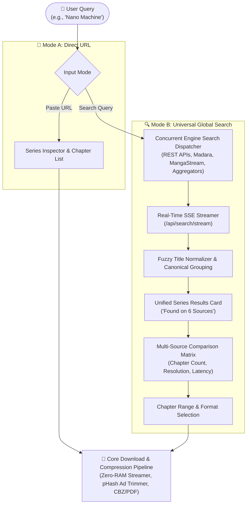
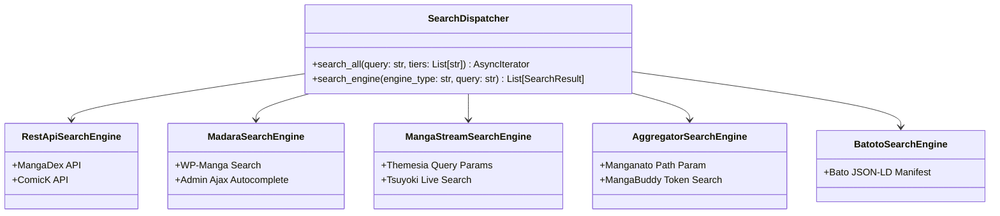
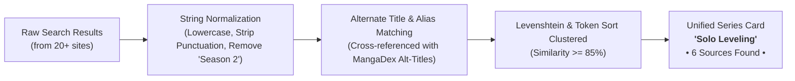

# 🔍 Universal Cross-Platform Search & Multi-Source Aggregation Specification
## Technical Architecture, Engine Dispatcher, and Unified Chapter Matrix

---

## 📌 1. Executive Summary & Vision

Currently, **Universal Manhua Extractor** relies on users manually locating a series in an external web browser, copying its chapter or series URL, and pasting it into the input box for inspection and downloading.

While the Direct URL input method is fast and precise, it requires users to:
1. Manually open a browser and endure intrusive pop-ups, redirects, and aggressive banner ads on aggregator websites.
2. Manually check multiple websites to determine which scanlator or aggregator has the **highest image quality**, the **most up-to-date chapters**, or the **cleanest translations**.

### 🎯 The Core Vision:
Transform Universal Manhua Extractor into an **all-in-one discovery, cross-site search, and multi-source aggregator**, while retaining the existing Direct URL method:



---

## 🏗️ 2. Core Architecture & Design Principles

### 2.1 Dual-Input Toggle Paradigm
The UI will feature a seamless top toggle switch:
* **`[ 🔍 Global Search ]` (New Default)**: Search by title, author, or keyword across all supported platforms simultaneously.
* **`[ 🔗 Direct URL / Inspector ]` (Existing)**: Immediate pasting of specific chapter/series URLs for power users and automation.

### 2.2 Concurrency & Real-Time Server-Sent Events (SSE)
Searching dozens of platforms sequentially would take 30+ seconds and feel sluggish. The solution uses an **asynchronous streaming model**:
1. When the user submits a search query, the frontend connects to `GET /api/search/stream?q={query}&sources={tier}` via **Server-Sent Events (SSE)**.
2. The backend launches non-blocking asynchronous coroutines across supported platforms throttled by an `asyncio.Semaphore(12)`.
3. Results stream to the frontend in **real time** as each platform responds. The user starts seeing results in **under 800ms**, even while other slower platforms are still resolving.
4. Fast sources (like REST APIs) populate immediately; slower web scrapers fill in progressively.

### 2.3 Tiered Source Selection
To prevent network congestion and respect site rate-limits, searches are grouped into source tiers:
* **⚡ Tier 1: Fast APIs & Top Scanlators** (*Default active*): MangaDex (v5 REST API), ComicK (v1 API), Asura Scans, Flame Comics, MangaNato, MangaFire, MangaBuddy.
* **🌸 Tier 2: WP Madara Network**: Toonily, KunManga, MangaTX, TopManhua, Hiperdex, ManhuaUS, WestManga, etc.
* **🌊 Tier 3: MangaStream & Themesia**: Reaper Scans, Drake Scans, ZeroScans, Hive Scans, Surya Scans, Omega Scans.
* **📦 Tier 4: Aggregators & Archives**: MangaFox, MangaHere, MangaPill, MangaFreak, Batoto.

> [!TIP]
> Users can toggle "Search All (89+ Sites)" or select specific tiers via quick chip filters (`⚡ Fast APIs`, `🔥 Top Scanlators`, `🔞 18+ Only`, `🌐 All Sites`).

---

## ⚡ 3. Engine-Aware Search Implementation

Each supported website family handles search queries differently. The `SearchDispatcher` categorizes platforms into 5 search paradigms:



### 3.1 Fast REST API Search (MangaDex, ComicK)
Direct JSON responses with zero HTML scraping:
* **MangaDex**:
  ```http
  GET https://api.mangadex.org/manga?title={query}&limit=10&includes[]=cover_art
  ```
  Extracts title, localized alternative titles, author, artist, tags, and cover image hash directly from the JSON payload.
* **ComicK**:
  ```http
  GET https://api.comick.fun/v1.0/search?q={query}&t=false
  ```
  Returns instantaneous JSON manifests containing series slugs, comic titles, and latest chapter numbers.

### 3.2 WordPress Madara Search Engine
Madara platforms support standardized query strings:
* **Standard GET Search**:
  ```http
  GET https://{domain}/?s={query}&post_type=wp-manga
  ```
* **High-Speed Ajax Autocomplete Endpoint**:
  ```http
  POST https://{domain}/wp-admin/admin-ajax.php
  Content-Type: application/x-www-form-urlencoded

  action=wp-manga-search-manga&title={query}
  ```
  Returns lightweight JSON snippets containing title, URL, and thumbnail without downloading full HTML search pages.

### 3.3 MangaStream / Themesia Search Engine
Themesia and Tsuyoki scanlator skins utilize query parameter indexing:
* **Search Request**:
  ```http
  GET https://{domain}/?s={query}
  ```
* **DOM Selectors**:
  - Container: `.listupd .bsx` or `.film_list-wrap .flw-item`
  - Title: `.tt a`, `.bigor .tt`, or `h4`
  - URL: `a[href*="/manga/"]` or `a[href*="/series/"]`
  - Cover: `img.ts-post-image` or `img[data-src]`
  - Latest Chapter badge: `.epxs` or `.chapter-badge`

### 3.4 Aggregator Search Engine
Aggregators frequently encode queries directly into the URL path or slug:
* **Manganato / ChapManganato**:
  ```http
  GET https://manganato.com/search/story/{query_slug}
  ```
  Where `query_slug` replaces spaces with underscores (`solo_leveling`).
* **MangaPill**:
  ```http
  GET https://mangapill.com/search?q={query}
  ```
* **MangaKatana**:
  ```http
  GET https://mangakatana.com/?search={query}&search_by=book_name
  ```

---

## 🧬 4. Fuzzy Title Clustering & Canonical Unification

When searching across 10+ sources, the same title will appear multiple times with slight spelling variations, punctuation differences, or romanized translations:
* Source A (Flame): *Solo Leveling*
* Source B (Asura): *Solo Leveling (Official)*
* Source C (MangaDex): *Na Honjaman Level Up*
* Source D (Aggregator): *I Alone Level-Up*

If presented as separate cards, the search result page becomes cluttered and repetitive.

### 4.1 Canonical Grouping Pipeline



### 4.2 Algorithm Specification
1. **Sanitization**: Lowercase, strip bracketed noise (`[Season 2]`, `(Official)`, `[Official Translation]`, `(Remake)`), remove special symbols (`-`, `:`, `!`, `?`).
2. **Token Sort Ratio**: Compare sets of words regardless of word order (`Solo Leveling` == `Leveling Solo`).
3. **MangaDex Global Alias Indexing**: When MangaDex returns a match, its `altTitles` array (containing Chinese, Korean Hangul, and Romanized titles) acts as a canonical alias bridge. Any hit matching an alt-title automatically folds into the same primary card.

---

## 📊 5. Multi-Source Comparison Matrix (Source Drawer)

When a user taps or clicks on a grouped series card, a **Source Comparison Drawer/Modal** opens:

### 5.1 Source Attributes Matrix
| Column | Attribute | Description |
| :--- | :--- | :--- |
| **Source** | Site Logo & Name | Verified platform icon, domain link, and engine type. |
| **Total Chapters** | Count & Range | Total number of published chapters (e.g. `210 Chapters (Ch. 1 - 210)`). |
| **Latest Chapter** | Most Recent Chapter | Title/number of the latest release (e.g. `Ch. 210 • 2 hours ago`). |
| **Quality** | Image Format & Resolution | Resolution tag (`1080p WebP`, `1440p HQ`, `Original RAW`, `Compressed JPG`). |
| **Health** | Response Latency | Network ping & Cloudflare bypass reliability (`🟢 Fast (320ms)`, `🟡 Moderate (1.2s)`). |
| **Action** | Action Buttons | `[ Preview Chapters ]` or `[ ⚡ Quick Download ]`. |

### 5.2 UI Mockup: Source Comparison Drawer
```text
┌────────────────────────────────────────────────────────────────────────┐
│ 📖 Solo Leveling (Na Honjaman Level Up)                                │
│ Action, Fantasy, Supernatural • 6 Sources Found                        │
├────────────────────────────────────────────────────────────────────────┤
│ Select a Source to Download or Preview Chapters:                       │
│                                                                        │
│ 🔘 [Flame Comics]   ⚡ Latest: Ch. 210  •  1080p WebP  •  🟢 280ms      │
│    210 Chapters  |  Official scanlator, zero watermark, high-res      │
│    [ Inspect Chapters ]  [ ⚡ Download All ]                           │
│                                                                        │
│ ⚪ [Asura Scans]     ⚡ Latest: Ch. 210  •  1080p WebP  •  🟢 340ms      │
│    210 Chapters  |  Full ribbon webtoon format                         │
│    [ Inspect Chapters ]  [ ⚡ Download All ]                           │
│                                                                        │
│ ⚪ [MangaDex]        ⚡ Latest: Ch. 200  •  Lossless PNG •  🟢 180ms      │
│    200 Chapters  |  Community uploads, multi-language                  │
│    [ Inspect Chapters ]  [ ⚡ Download All ]                           │
│                                                                        │
│ ⚪ [Manganato]       ⚡ Latest: Ch. 210  •  720p JPG   •  🟡 650ms      │
│    210 Chapters  |  Fast mirror fallback                               │
│    [ Inspect Chapters ]  [ ⚡ Download All ]                           │
└────────────────────────────────────────────────────────────────────────┘
```

---

## 🔌 6. REST API & Data Contracts

### 6.1 Real-Time Streaming Search: `GET /api/search/stream`
* **Query Parameters**:
  - `q` (*string, required*): The search keyword (e.g., `solo leveling`).
  - `tier` (*string, optional*): Filter by source tier (`fast`, `popular`, `all`, `18+`). Default: `fast`.
  - `limit` (*integer, optional*): Maximum results per platform. Default: `5`.
* **Response Content-Type**: `text/event-stream`
* **SSE Event Types**:
  1. `init`:
     ```json
     {"total_sources": 16, "query": "solo leveling", "session_id": "s_9f3a1"}
     ```
  2. `source_hit`:
     ```json
     {
       "source_key": "asura",
       "source_name": "Asura Scans",
       "source_logo": "/docs/logos/asura.png",
       "series_title": "Solo Leveling",
       "canonical_id": "solo-leveling",
       "series_url": "https://asuracomic.net/series/solo-leveling-xyz",
       "cover_url": "https://cdn.asura.gg/covers/solo.jpg",
       "latest_chapter": "Chapter 210",
       "latest_chapter_num": 210.0,
       "rating": 9.8
     }
     ```
  3. `source_progress`:
     ```json
     {"completed": 7, "total": 16, "current_source": "MangaDex"}
     ```
  4. `complete`:
     ```json
     {"total_hits": 24, "canonical_groups": 3, "elapsed_seconds": 1.45}
     ```

### 6.2 Series Chapter Inspection: `GET /api/inspect?url={series_url}`
Existing endpoint already built in Step 1! Returns the full live chapter array:
```json
{
  "success": true,
  "series_title": "Solo Leveling",
  "cover_url": "https://...",
  "source_name": "Flame Comics",
  "total_chapters": 210,
  "chapters": [
    {"chapter_num": 210.0, "title": "Chapter 210", "url": "https://..."},
    {"chapter_num": 209.0, "title": "Chapter 209", "url": "https://..."}
  ]
}
```

---

## 🎨 7. Frontend User Experience (Web & Android)

### 7.1 Search Screen Workflow
1. **Interactive Search Input**:
   - Centered input bar with instantaneous clear button (`✕`) and magnifying glass animation.
   - Debounce of 400ms on typing or instant trigger on `Enter` / clicking `Search`.
2. **Live Discovery Skeleton**:
   - Beautiful glowing skeleton cards while waiting for initial SSE packets.
   - Smooth card transitions as new canonical groups appear.
3. **Canonical Card Display**:
   - High-definition series cover on the left.
   - Title in bold, alternative titles in muted text.
   - Source pill counter: `[ 🌐 5 Sources Available ]`.
   - Latest chapter indicator: `Latest: Ch. 210`.
4. **Source Selection & Chapter Inspector Modal**:
   - Clicking a card pops open a modal showing all 5 sources with their specific chapter counts and health status.
   - Clicking **"Inspect"** on any source immediately displays all checkboxes for that source's chapters.
   - Batch selection tools: **"Select All"**, **"Unread Only"**, **"Latest 5"**, or range selection **"1 - 50"**.
   - One-click **"Download Selected"** automatically kicks off the download worker and shifts focus to the active download queue!

---

## 🛡️ 8. Robustness, Rate Limiting & Safety

To ensure search never breaks or triggers anti-bot bans:
1. **Concurreny Throttling (`asyncio.Semaphore`)**:
   - Maximum 10-12 simultaneous outgoing network requests to prevent socket exhaustion on mobile devices and low-spec home servers.
2. **Per-Engine Timeout**:
   - Hard 3.5-second timeout per individual site coroutine using `asyncio.wait_for`. If a site is experiencing DDoS or Cloudflare delays, it aborts gracefully without blocking the rest of the search.
3. **In-Memory LRU Search Cache**:
   - Cache results for 20 minutes (`cachetools.TTLCache(maxsize=200, ttl=1200)`). Repeating the same query or navigating back delivers instant 0ms responses.
4. **TLS Fingerprint Rotation (`curl_cffi`)**:
   - Every search request uses Chrome 124 browser TLS impersonation to bypass Cloudflare Bot Management on search endpoints.

---

## 🗺️ 9. Step-by-Step Implementation Roadmap

| Step | Milestone | Deliverables | Status |
| :---: | :--- | :--- | :---: |
| **1** | **Search Dispatcher Core** | `core/search/dispatcher.py` with multi-engine search adapters (MangaDex, ComicK, Madara, MangaStream, Aggregators). | ⏳ Ready |
| **2** | **Fuzzy Deduplication Engine** | `core/search/clustering.py` for token sort ratio and canonical alias grouping. | ⏳ Ready |
| **3** | **Streaming REST API** | FastAPI SSE `/api/search/stream` and fallback `/api/search` endpoints. | ⏳ Ready |
| **4** | **Web GUI Search Interface** | Dual-tab toggle (`[ Search ]` / `[ URL ]`), interactive results grid, and Source Drawer in `static/index.html`. | ⏳ Ready |
| **5** | **Android App Integration** | Touch-friendly search keyboard handling, native drawer transitions, and responsive layout. | ⏳ Ready |
| **6** | **Automated Unit Testing** | `tests/test_search_engine.py` covering deduplication, timeouts, and multi-source chapter synchronization. | ⏳ Ready |

