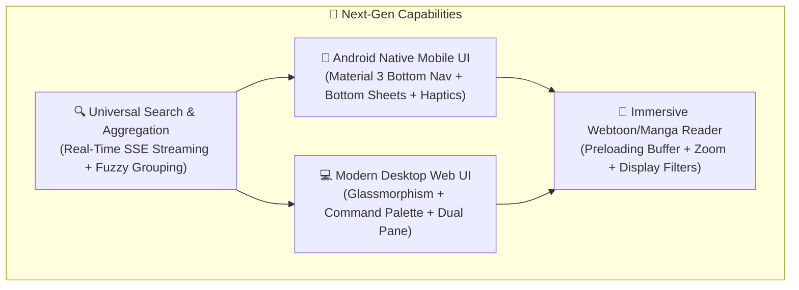
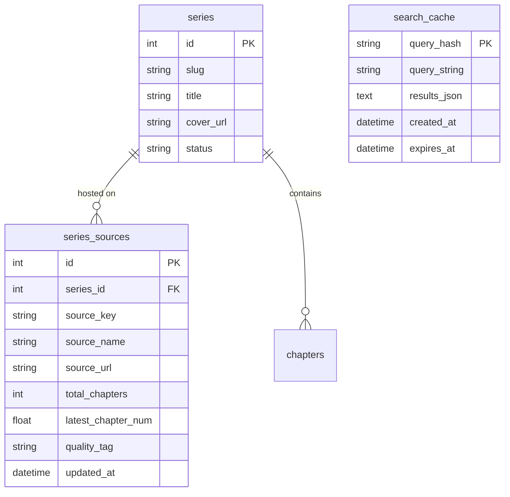
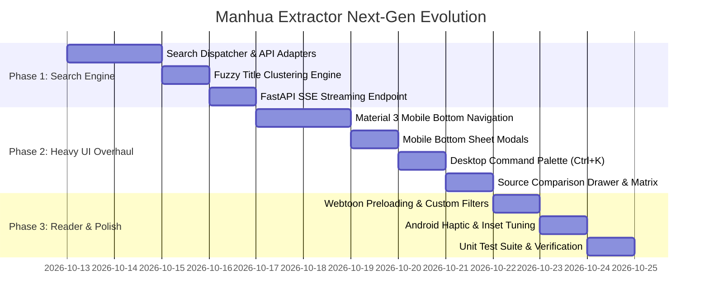

# 🚀 Universal Manhua Extractor: Master Improvement & UI/UX Evolution Plan
## Architecture Modernization, Universal Multi-Source Search, and Next-Gen Mobile/Web UI

---

## 📌 1. Executive Summary & Current Project State

Universal Manhua Extractor has evolved through releases **v1.0.0 through v1.0.5** into a production-grade manga extraction suite. Before detailing the next major evolution, here is where the project stands today:

### ✅ Already Implemented & Shipped (v1.0.0 – v1.0.5)
* 🧠 **6 Extraction Engines across 89 Verified Platforms**: Modern SSR (Astro/Next.js), WP Madara, MangaStream/Themesia, Aggregators, Batoto, and Universal Heuristic Crawler.
* 🛡️ **Bypass & Anti-Bot Subsystem**: TLS fingerprint impersonation (Chrome 124 via `curl_cffi`), Cloudflare Turnstile token handling, anti-hotlink CDN referer spoofing.
* 📱 **Standalone Android Application**: Native APK with embedded Chaquopy Python 3.11, Uvicorn, and Android Foreground Service for screen-off background downloads.
* 📡 **Wireless OPDS 1.2 Catalog**: Zero-cable streaming into Mihon, Tachiyomi, Moon+ Reader, and Panels at `/opds/v1.2/catalog`.
* 📦 **Atomic Backup & Multi-Volume Sync**: Single ZIP or split 1.5 GB sequential multi-volume backup engine with Zip-Slip rejection and multi-key SQLite database merging.
* ✂️ **Reading Enhancements**: Kindle E-Ink whitespace energy-histogram slicer and 128-bit perceptual hashing (pHash) ad/promo filtering.
* 🐳 **Production Docker Container**: Published on Docker Hub as [`adityapatra/manhua-extractor:latest`](https://hub.docker.com/r/adityapatra/manhua-extractor) with multi-volume persistence and automated healthchecks.

---

## 🎯 2. Next Horizon: Core Objectives

Based on user feedback, the two primary pillars of this evolution are:

1. **Integrating Universal Cross-Platform Search & Multi-Source Aggregation** ([`GLOBAL_SEARCH_AND_MULTI_SOURCE_SPEC.md`](GLOBAL_SEARCH_AND_MULTI_SOURCE_SPEC.md)):
   Eliminate the friction of opening external browsers, dodging intrusive popups, and copying URLs. Users can search any title directly, see which platforms host it, compare chapter counts and quality, and download in 1 click.
2. **Heavy UI/UX Redesign for Both Android Mobile & Web/Desktop**:
   Elevate the interface from a functional developer dashboard to an ultra-modern, fluid, Material 3 Expressive mobile app and desktop reading hub.



---

## 🔍 3. Universal Search & Multi-Source Aggregator Integration

*(Full technical specification referenced from [`GLOBAL_SEARCH_AND_MULTI_SOURCE_SPEC.md`](GLOBAL_SEARCH_AND_MULTI_SOURCE_SPEC.md))*

### 3.1 Dual-Input Top Bar
The interface maintains backward compatibility with the existing direct URL paste while prioritizing search:
* **`[ 🔍 Search Series ]` (Default)**: Enter a title like *"Solo Leveling"* or *"Nano Machine"* to query all platforms.
* **`[ 🔗 Direct URL / Inspector ]`**: Direct chapter/series URL pasting for power users and automation scripts.

### 3.2 Real-Time SSE Search Pipeline
Rather than blocking for 20+ seconds while dozens of sites resolve, the backend streams results live via Server-Sent Events (`/api/search/stream`):
1. User types query `q="solo leveling"`.
2. Fast REST API engines (MangaDex, ComicK) return results in **< 800ms**.
3. Madara and MangaStream scrapers resolve concurrently via `asyncio.Semaphore(12)` with a 3.5s per-site timeout.
4. Cards populate with smooth fade-in animations as results arrive.

### 3.3 Fuzzy Deduplication & Canonical Grouping
Multiple sources reporting the same manhwa under slight variations (*"Solo Leveling"*, *"Solo Leveling (Official)"*, *"I Alone Level-Up"*, *"Na Honjaman Level Up"*) are unified into **one canonical card**:
* **Card Badge**: Displays `[ 🌐 Found on 6 Sources ]` and `Latest: Ch. 210`.
* **Cover Art Selection**: High-definition poster prioritized from MangaDex/ComicK.

### 3.4 Multi-Source Comparison Drawer
Tapping a unified series card slides up a **Source Comparison Drawer**:
* Shows each source's platform icon, latest chapter, total chapters, estimated resolution (1080p WebP vs 720p JPG), and network latency.
* **1-Click "Inspect Chapters"**: Loads checkboxes for all chapters from that specific source.
* **1-Click "Download All"**: Enqueues the full series into the background downloader.

---

## 🎨 4. Heavy UI/UX Redesign: Android Native Mobile Experience

The Android APK currently wraps the web interface in a fullscreen WebView. We will upgrade this into a **native-feeling Material 3 Expressive mobile interface**:

```text
┌─────────────────────────────────────────────────────────┐
│ 12:00 📶 🔋 100%                                        │
│                                                         │
│ 🔍 Search manhwa, authors, genres...               [⚡] │
│ ─────────────────────────────────────────────────────── │
│ [ ⚡ Fast APIs ]  [ 🔥 Scanlators ]  [ 🌸 Madara ]  [ 🌐 All ] │
│                                                         │
│ ┌─────────────────────────────────────────────────────┐ │
│ │ ┌──────────┐  Solo Leveling                         │ │
│ │ │          │  Ch. 1 - 210 (Complete)                │ │
│ │ │  POSTER  │  Action, Fantasy, Dungeons             │ │
│ │ │          │  🌐 6 Sources Available                │ │
│ │ └──────────┘  [ Compare Sources ]  [ ⚡ Quick DL ]   │ │
│ └─────────────────────────────────────────────────────┘ │
│ ┌─────────────────────────────────────────────────────┐ │
│ │ ┌──────────┐  Nano Machine                          │ │
│ │ │  POSTER  │  Ch. 218 • 2 hours ago                 │ │
│ │ └──────────┘  🌐 4 Sources Available                │ │
│ └─────────────────────────────────────────────────────┘ │
│                                                         │
├─────────────────────────────────────────────────────────┤
│   [🔍 Search]     [📚 Library]     [📥 Queue]     [⚙️ Settings] │
└─────────────────────────────────────────────────────────┘
```

### 4.1 Mobile-First Architectural Upgrades
1. **Material 3 Bottom Navigation Bar**:
   - Replace top desktop header tabs with an ergonomic bottom navigation bar:
     - **🔍 Discover**: Global search, trending manhwa, and direct URL input.
     - **📚 Library**: Offline downloaded series cards, reading progress badges, and filter chips.
     - **📥 Queue**: Active downloads with speed gauges (MB/s), live chapter thumbnails, and pause/resume buttons.
     - **⚙️ Settings**: Backup & multi-volume sync, OPDS server status, e-ink slicer toggles, and tracker scrobbling.
2. **Full Edge-to-Edge Experience (`WindowInsetsCompat`)**:
   - Transparent system status bar and navigation gesture bar.
   - Dynamic viewport insets so cards and buttons never collide with camera punch-holes or rounded device corners.
3. **Mobile Bottom Sheet Modals (Drag-to-Dismiss)**:
   - Replace desktop centered popups with native bottom sheets that slide up from the bottom with snap points (Half screen preview, Full screen chapter list).
   - Drag down to dismiss with fluid momentum physics.
4. **Haptic Feedback & Micro-Interactions**:
   - Subtle tactile vibrations (`HapticFeedbackConstants.CLOCK_TICK`) when toggling chapter checkboxes, starting a download, or switching tabs.
5. **AMOLED Pure Black Theme (`#000000`)**:
   - True black background option for OLED smartphone displays to maximize battery life during long downloads and reading sessions.
6. **Pull-to-Refresh Gesture**:
   - Native pull-to-refresh on Library to check for new chapter releases via `core/updater.py`.

---

## 💻 5. Heavy UI/UX Redesign: Desktop Web & Tablet Experience

For local PC, Raspberry Pi, home server, and Docker deployments, the web dashboard will receive a modern desktop redesign:

```text
┌───────────────────────────────────────────────────────────────────────────────┐
│ ⚡ MANHUA EXTRACTOR   [ 🔍 Search (Ctrl+K) ]   [ 📥 3 Active ]  [ 📚 42 Series ] │
├──────────────────────────────────────┬────────────────────────────────────────┤
│ 🔍 GLOBAL SEARCH RESULTS             │ 📖 SERIES INSPECTOR & CHAPTER MATRIX   │
│ Query: "Nano Machine"                │                                        │
│                                      │ ┌─────────┐  Nano Machine              │
│ ┌──────────────────────────────────┐ │ │         │  By Jeol-Moo-Chi           │
│ │ ┌─────┐ Nano Machine             │ │ │ COVER   │  Status: Ongoing           │
│ │ │ PIC │ 218 Chs • 4 Sources      │ │ │         │  Latest: Chapter 218       │
│ │ └─────┘ Asura, Flame, Dex, Nato  │ │ └─────────┘                            │
│ ├──────────────────────────────────┤ ├────────────────────────────────────────┤
│ │ ┌─────┐ Nano Machine: Past       │ │ 🔘 Flame Comics  [ 218 Chs • 1080p ]    │
│ │ │ PIC │ Prequel • 120 Chs        │ │ ⚪ Asura Scans    [ 218 Chs • WebP ]     │
│ │ └─────┘ ComicK, MangaDex         │ │ ⚪ MangaDex       [ 205 Chs • Lossless ] │
│ └──────────────────────────────────┘ ├────────────────────────────────────────┤
│                                      │ Chapter Selection (15 Selected):       │
│                                      │ [ Select All ] [ Latest 5 ] [ Range: ] │
│                                      │ [x] Chapter 218 (Latest)               │
│                                      │ [x] Chapter 217                        │
│                                      │ [x] Chapter 216                        │
│                                      │ [ 🚀 Download Selected as CBZ ]        │
└──────────────────────────────────────┴────────────────────────────────────────┘
```

### 5.1 Desktop & Tablet Enhancements
1. **Command Palette (`Ctrl+K` / `Cmd+K`)**:
   - Global keyboard modal for rapid power search, jumping to any library series, or triggering quick actions (`Update Library`, `Export Backup`, `Open Reader`).
2. **Dual-Pane Split Layout (Desktop & Tablets)**:
   - Left Pane: Live search results or library series list with infinite scrolling.
   - Right Pane: Active series inspector, chapter matrix, and source comparison without navigating away.
3. **Multi-Job Concurrency Download Monitor**:
   - Floating download widget showing active download speed, ETA countdown, panel progress bars, and cancel/pause controls for individual chapters.
4. **Enhanced Built-in Reader (`/read/{chapter_id}`)**:
   - **Continuous Webtoon Ribbon**: Pre-buffers next 10 panels in memory for zero lag during fast scrolling.
   - **Directional Manga Mode**: Left-to-Right (LTR) or traditional Right-to-Left (RTL) reading with keyboard navigation (`Arrow keys`, `A/D`, `Spacebar`).
   - **Reader Customization Drawer**:
     - Image Width slider (Fit Width, 75%, 100%, Original).
     - Gutter spacing slider (remove gaps or add spacing between strips).
     - Color Temperature filter (Normal, OLED Black, Warm Sepia, Eye-Care Dark).
     - Fullscreen toggle (`F` key).

---

## 🗄️ 6. Database Schema Additions (`database/db.py`)

To support multi-source tracking and instant search caching, 3 lightweight SQLite tables are introduced:



### 6.1 `search_cache` Table
Prevents repeated scraping when users search the same title:
```sql
CREATE TABLE IF NOT EXISTS search_cache (
    query_hash TEXT PRIMARY KEY,
    query_string TEXT NOT NULL,
    results_json TEXT NOT NULL,
    created_at TIMESTAMP DEFAULT CURRENT_TIMESTAMP,
    expires_at TIMESTAMP NOT NULL
);
```

### 6.2 `series_sources` Table
Maps which external websites host the series for instant multi-source updates:
```sql
CREATE TABLE IF NOT EXISTS series_sources (
    id INTEGER PRIMARY KEY AUTOINCREMENT,
    series_id INTEGER NOT NULL REFERENCES series(id) ON DELETE CASCADE,
    source_key TEXT NOT NULL,
    source_name TEXT NOT NULL,
    source_url TEXT NOT NULL,
    total_chapters INTEGER DEFAULT 0,
    latest_chapter_num REAL DEFAULT 0,
    quality_tag TEXT DEFAULT 'Standard',
    latency_ms INTEGER DEFAULT 0,
    updated_at TIMESTAMP DEFAULT CURRENT_TIMESTAMP,
    UNIQUE(series_id, source_key)
);
```

---

## 🛠️ 7. Phased Implementation Roadmap



### Phase 1: Search Core & Backend Services
* **`core/search/dispatcher.py`**: Multi-engine search manager dispatching async coroutines to MangaDex, ComicK, Madara, MangaStream, and Aggregators.
* **`core/search/clustering.py`**: Title sanitization, Token Sort Ratio, and MangaDex alias mapping to cluster hits into canonical series cards.
* **`app.py`**: Implement `/api/search/stream` (SSE) and `/api/search` endpoints.

### Phase 2: Heavy UI / UX Redesign
* **Mobile Bottom Nav**: Fixed bottom bar with icons for Search, Library, Queue, and Settings.
* **Bottom Sheet Component**: Lightweight, drag-to-dismiss bottom sheet for source comparison and chapter inspection on mobile.
* **Desktop Split View & Command Palette**: Two-column layout with `Ctrl+K` keyboard shortcut.
* **Dual-Mode Input Bar**: Seamless tab switch between Search and Direct URL.

### Phase 3: In-App Reader & Mobile Touch Polish
* **Reader Performance**: Pre-buffer next 10 webtoon panels in memory.
* **Reader Controls**: Brightness/OLED black filters, zoom scaling, gap adjustment, and keyboard navigation.
* **Android Native Bridges**: Haptic vibration feedback, safe gesture insets, and pull-to-refresh on library cards.

### Phase 4: Test Suite & Verification
* Expand unit test suite with `tests/test_search_engine.py` covering fuzzy clustering, network timeouts, and multi-source chapter synchronization.

---

## 🎯 8. Success Criteria & Verification Checklist

1. [ ] **Instant Search Response**: Streaming results appear on screen within 800ms for fast REST APIs.
2. [ ] **No Duplicate Clutter**: Hits from multiple scanlators for the same title fold cleanly into a single card with a `Found on X Sources` badge.
3. [ ] **Seamless Source Comparison**: Tapping a card displays a side-by-side comparison of all sources (latest chapter, total chapters, resolution, ping).
4. [ ] **1-Click Downloading**: Selecting chapters from any source seamlessly kicks off the existing background download, ad-filtering, and CBZ compiler.
5. [ ] **Direct URL Preserved**: Users can still paste specific chapter or series URLs under the `[ 🔗 Direct URL ]` tab.
6. [ ] **Mobile Touch Polish**: Full edge-to-edge layout, bottom navigation bar, and bottom sheet modals on Android.
7. [ ] **Desktop Power Tools**: `Ctrl+K` search modal and dual-pane layout on PC/Tablet.
