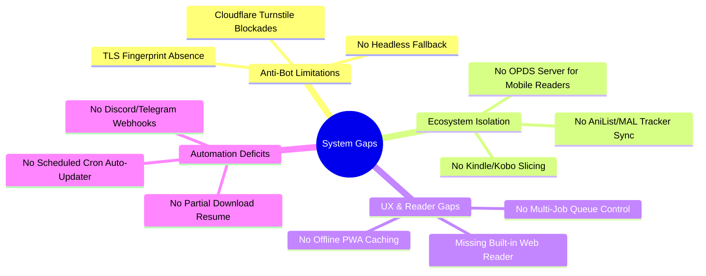

# Universal Manhua Extractor: Future Roadmap & Enhancement Blueprint

A comprehensive, production-grade architectural analysis outlining current project gaps, structural limitations, and a phased feature roadmap to transform this project into an enterprise-class Manga/Manhua automation suite.

---

## 1. Executive Gap Analysis: Where the Project Currently Stands

While the current system successfully implements the **5-Engine modular architecture**, **SQLite indexing**, and a **FastAPI/SSE Web GUI**, real-world production use across diverse hosting environments (Termux, Raspberry Pi, VPS, Local Desktop) reveals several technical ceilings:

---

## 2. Category 1: Network, TLS & Anti-Bot Engineering (Closing the Final 5%)

### The Problem
`cloudscraper` relies on parsing legacy Cloudflare JavaScript challenges. Modern anti-bot services (Cloudflare Turnstile, DataDome, Akamai, Kasada) examine the **JA3/JA4 TLS handshake fingerprint** and **HTTP/2 frame parameters**. Standard Python `requests` or `aiohttp` emit Python-specific TLS ciphers, causing immediate 403 blocks regardless of User-Agent headers.

### High-Impact Enhancements:
1. **`curl_cffi` / TLS Fingerprint Impersonation**:
   * Replace `requests` with `curl_cffi` to mimic Chrome 120+ TLS fingerprints, cipher suites, ALPN, and HTTP/2 settings at the C-level.
   * Bypasses 90% of Cloudflare Turnstile non-interactive checks with zero browser overhead.
2. **Headless Browser Sidecar (Playwright Stealth / DrissionPage)**:
   * Maintain an optional micro-worker that spins up a headless Chromium instance **only when a 403 Challenge is detected**.
   * Solves interactive Turnstile checkboxes, grabs session cookies (`cf_clearance`), and passes them back to the fast async aiohttp pool.
3. **FlareSolverr / Prowlarr Webhook Connector**:
   * Add configuration support for users who already run a `FlareSolverr` container on their home network to route protected URLs automatically.
4. **Per-Domain Rate Limiting & Proxy Rotation**:
   * Add token-bucket rate limiters per domain (e.g., maximum 3 requests/sec on aggressive CDNs) to eliminate IP throttling and temporary bans.

---

## 3. Category 2: In-App Web Reader & User Experience

### The Problem
Currently, users must open downloaded PDFs/CBZs in an external app. A modern manga tool should provide a seamless in-browser reading experience with persistent progress tracking.

### High-Impact Enhancements:
1. **Built-in Webtoon Vertical Reader**:
   * **Infinite Continuous Scroll**: Smooth Webtoon-style reading directly inside the Web GUI (`/read/{chapter_id}`).
   * **Pre-fetching Engine**: Seamlessly buffers upcoming panels into memory for zero stutter during fast scrolling.
2. **Manga Reader Mode**:
   * Traditional Right-to-Left (RTL) reading orientation with single-page and double-page spread views.
3. **Reading State Synchronization**:
   * Saves reading progress (`last_read_page`, `last_read_chapter`) in SQLite `chapters` table.
   * Auto-scrolls to the exact panel where the user left off.
4. **Progressive Web App (PWA) Offline Support**:
   * Provide a PWA service worker so users on Android/iOS can add the web app to their home screen and read cached chapters without internet access.

---

## 4. Category 3: Automated Tracker & Library Lifecycle

### The Problem
Users currently have to manually check their favorite series online to see if new chapters have been released.

### High-Impact Enhancements:
1. **Scheduled Auto-Updater (Cron / APScheduler)**:
   * Background daemon that periodically scans all tracked series in `library.db` (e.g., every 6 or 12 hours).
   * Checks the latest chapter on the source site; if newer than the database index, automatically enqueues and downloads the new chapters.
2. **Webhook & Notification Alerts**:
   * **Discord Webhook**: Sends a rich embed with the chapter cover, title, chapter number, and file size to a Discord channel.
   * **Telegram Bot**: Sends push messages directly to the user's phone via Telegram bot API.
   * **Gotify / Ntfy**: Self-hosted notification push integration.
3. **Smart Catch-Up Engine**:
   * "Download Missing Gaps": Detects if chapters 1, 2, 4, 5 are downloaded and offers a 1-click button to retrieve chapter 3.

---

## 5. Category 4: Media Server & Ecosystem Integrations

### The Problem
The extractor operates as an isolated island. Comic readers and manga trackers are not aware of the local library.

### High-Impact Enhancements:
1. **Embedded OPDS 1.2 / 2.0 Catalog Feed (`/opds/v1.2/catalog`)**:
   * Expose an Open Publication Distribution System (OPDS) XML/JSON feed.
   * Allows external mobile apps (like **Tachiyomi**, **Mihon**, **Tachimanga**, **Chunky**, **Moon+ Reader**, **Panels**) to connect directly over local Wi-Fi and browse/read downloaded series without manual file copying.
2. **AniList / MyAnimeList / Kitsu Scrobbler**:
   * Sync reading progress with official tracking services.
   * When Chapter 15 is marked as read in the database, automatically updates the user's AniList profile.
3. **Enhanced ComicInfo.xml & Metadata Scraper**:
   * Query MangaDex / AniList / MangaUpdates APIs to pull official metadata:
     * Author, Artist, Genres, Demographic (Shounen, Seinen), Status, Age Rating.
   * Injects standardized `<ComicInfo.xml>` inside all compiled CBZ archives for Komga, Kavita, and ComicRack compatibility.

---

## 6. Category 5: Advanced Image Engineering & Device Slicing

### The Problem
Webtoons are designed as continuous vertical ribbons, which are unreadable on e-ink devices (Kindle, Kobo) or low-bandwidth environments.

### High-Impact Enhancements:
1. **Smart E-Ink / Kindle Page Slicer**:
   * Webtoons have tall strips ($1080 \times 16000$ px).
   * Implement an **intelligent whitespace detection algorithm** that scans strips for natural panel gaps and slices them into fixed aspect-ratio pages ($1264 \times 1680$ or Kindle Paperwhite dimensions).
   * Direct output option for `.mobi` or Kindle-compatible PDF.
2. **Next-Gen Image Encoders (AVIF / JXL / WebP)**:
   * Provide option to compress panels to **AVIF** or **WebP** rather than standard JPEG:
     * 40–60% reduction in storage space.
     * Retains sharp line art and color gradients in digital manhwa panels.
3. **Promotional & Ad Page Trimming (Perceptual Hashing)**:
   * Many aggregators prepend or append 1–3 promotional credit pages (e.g., Discord promos, site logos).
   * Use perceptual image hashing (`imagehash` library) to fingerprint known promotional pages and automatically exclude them from compiled PDFs/CBZs.
4. **AI Super-Resolution Microservice (Waifu2x / Real-ESRGAN)**:
   * Optional micro-service connector to upscale blurry 720p legacy manhua scans into crisp 4K line art before PDF assembly.

---

## 7. Category 6: Download Queue & Queue Resilience

### The Problem
Currently, downloads run sequentially in a single job. Interrupting the script requires restarting from the beginning of the chapter.

### High-Impact Enhancements:
1. **Persistent Multi-Job Queue**:
   * SQLite-backed queue manager:
     * Queue multiple series at once.
     * Pause, Resume, Reorder, or Cancel specific jobs.
2. **Panel-Level Download Cache & Resume**:
   * Cache downloaded panels in a temporary staging directory (`.staging/{chapter_hash}/`).
   * If a download is cancelled or loses Wi-Fi on panel 45 of 50, resuming downloads panels 46–50 and immediately compiles, saving bandwidth.
3. **Disk Quota & Auto-Purge Rules**:
   * Set storage caps (e.g., max 20 GB).
   * Auto-purge raw images once PDF/CBZ is successfully verified, or auto-archive read chapters.

---

## 8. Prioritized Implementation Matrix

| Feature | Impact | Effort | Target Milestone | Status |
|---|---|---|---|---|
| **In-App Vertical Web Reader** | 🔥 High | 🟢 Low | **v1.1** | ✅ **COMPLETE** |
| **`curl_cffi` TLS Fingerprint Engine** | 🔥 High | 🟡 Medium | **v1.1** | ✅ **COMPLETE** |
| **OPDS Server Feed for Tachiyomi/Mihon** | 🔥 High | 🟡 Medium | **v1.2** | ✅ **COMPLETE** |
| **Scheduled Auto-Updater Worker** | 🔥 High | 🟡 Medium | **v1.2** | ✅ **COMPLETE** |
| **Discord / Telegram / Ntfy Webhooks** | ⚡ Medium | 🟢 Low | **v1.2** | ✅ **COMPLETE** |
| **Kindle / E-Ink Smart Strip Slicer** | ⚡ Medium | 🟡 Medium | **v1.3** | ⏳ Next Up |
| **Panel-Level Cache & Resume** | 🔥 High | 🟡 Medium | **v1.3** | ⏳ Next Up |
| **AniList / MAL Tracker Sync** | ⚡ Medium | 🟡 Medium | **v1.4** | Planned |
| **Playwright Stealth Headless Fallback** | ⚡ Medium | 🔴 High | **v2.0** | Planned |
| **Ad / Credit Page Trimming (pHash)** | ⚡ Medium | 🟡 Medium | **v2.0** | Planned |
| **AI Waifu2x Upscaling Pipeline** | 💡 Optional | 🔴 High | **v2.1** | Research |

---

## 9. Next Recommended Action

1. **v1.3 Priority 1: Kindle / E-Ink Smart Strip Slicer**:
   * Implement automated whitespace detection in `core/optimizer.py` to intelligently segment long vertical webtoon strips into reader-friendly aspect ratios (e.g. 1264x1680) for e-readers and low-memory devices.
2. **v1.3 Priority 2: Panel-Level Download Staging & Resumption**:
   * Add panel-level caching in `core/downloader.py` using `.staging/{chapter_hash}/` to resume interrupted chapter downloads without refetching already completed panels.

