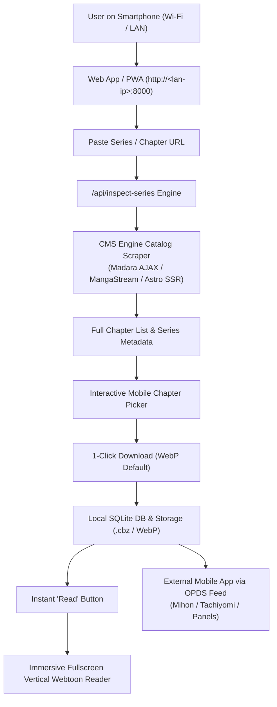

# 📱 Mobile-First Series Catalog, Ultra-Compact Storage & Immersive Reader Plan

## 1. Executive Summary & User Vision

The goal is to provide a seamless **mobile-first manga/manhua experience** accessible directly from a smartphone over local Wi-Fi:
1. **Paste any series or chapter link**: Instead of a blind download prompt, the system instantly indexes the source site and displays the **complete catalog of all available chapters** (just like the local Library bookshelf).
2. **Selective & Batch Downloading**: Users can browse chapters, select specific ones (e.g., Chapters 10–25) or "Download All", with live progress indicators.
3. **Instant "Read Now" Action**: The moment a chapter finishes downloading, an instant **"📖 Read"** button appears next to it.
4. **Best-in-Class Fullscreen Mobile Reader**: An immersive, continuous vertical webtoon reader with HTML5 Fullscreen API, tap-to-toggle HUD controls, pinch-to-zoom, and smooth prefetching.
5. **Ultra-Compact Storage (WebP Default)**: Standardizes on High-Efficiency WebP compression (yielding 40–75% storage savings over JPEG) to keep phone and server storage minimal.
6. **Mobile App Ecosystem Integration**: Chapters stored locally with direct download links and an embedded **OPDS 1.2 catalog feed** for external mobile reader apps (Mihon, Tachiyomi, Panels, Chunky).

---

## 2. Architecture & Technical Breakdown



---

## 3. Core Capabilities to Build

### 🔍 Feature 1: Universal Series Chapter Catalog Inspector (`/api/inspect-series`)
* **Problem**: Currently, passing a URL only analyzes that single chapter and looks for a simple `next_chapter_url`.
* **Solution**:
  * Build a dedicated catalog scraper for each CMS engine:
    * **Madara Engine**: Scrapes the complete chapter list via `ajax/chapters/` or the main manga home page (`wp-manga-chapter` elements).
    * **MangaStream / Themeia / Liliana**: Scrapes `#chapterlist` or `div.eplister` containing all numbered chapters with their release dates.
    * **Modern SSR (Astro / Next.js)**: Extracts the full chapter list from Astro island payload or JSON state on Asura Scans / Flame Comics.
    * **Aggregator Engine**: Scrapes `.row-content-chapter` from Manganato.
  * API endpoint `POST /api/inspect-series` accepts **either** a main series link or any chapter link, automatically resolves the series root, and returns:
    * `series_title`, `cover_url`, `synopsis`, `author`, `genres`
    * Complete array of `chapters`: `[{ chapter_num: 1.0, title: "Chapter 1", url: "...", is_downloaded: true/false, file_path: "..." }, ...]`

---

### 📱 Feature 2: Mobile Chapter Picker & Live Download UI
* **Visual Chapter Grid & List View**:
  * Displays all chapters in descending or ascending order.
  * Clear status badges:
    * 🟢 **Downloaded (Local)** -> Shows direct **"📖 Read"** button and download size.
    * ⚪ **Available Online** -> Shows **"⬇️ Download"** button and checkbox.
  * Multi-select toolbar:
    * "Select All", "Select Range (e.g. 1–20)", "Select Unread".
    * Batch action: **"Download Selected (X Chapters)"**.
* **Progressive Web App (PWA) Support**:
  * Include `manifest.json`, mobile theme colors, and icons so users on iOS and Android can tap **"Add to Home Screen"** to run it full-screen like a native mobile app.
  * Display LAN IP / QR Code in the CLI output on launch (e.g. `http://192.168.1.50:8000`) so the user can connect from their phone with one camera scan.

---

### 📖 Feature 3: Immersive Fullscreen Mobile Webtoon Reader
* **Fullscreen API**:
  * 1-Click Fullscreen button (`document.documentElement.requestFullscreen()`) that hides mobile browser address bars and system chrome.
* **Smart Tap HUD (Heads-Up Display)**:
  * Single tap anywhere in the center toggles the header, chapter switcher, and page scrubber.
  * Automatically hides controls while scrolling down so reading is 100% borderless and uncluttered.
* **Touch-Optimized Gestures**:
  * Smooth vertical inertia scrolling.
  * Floating quick-jump button ("Next Chapter ➡️", "Previous Chapter ⬅️").
  * Reading progress auto-saved per chapter in the database so resuming on mobile opens the exact page last read.
* **Perceptual Ad Marker on Mobile**:
  * Floating "🚫 Hide Ad" icon on every panel allowing 1-tap removal of site credit banners.

---

### 🗜️ Feature 4: Ultra-Compact WebP Storage
* **Default High-Efficiency WebP Pipeline**:
  * Enforces WebP compression by default: **40% to 75% smaller file sizes** compared to original JPEGs.
  * 100 chapters of Manhua occupy $\approx 1.5\text{ GB}$ instead of $6\text{ GB}$, saving massive phone and server storage.
* **Fast Decodable CBZ Packaging**:
  * Packages WebP panels inside standard `.cbz` archives with rich `<ComicInfo.xml>`.
  * Instant streaming in the web reader without decompressing the entire archive to disk.

---

### 📲 Feature 5: Direct Mobile App Integration (Mihon / Tachiyomi / Panels)
* **OPDS 1.2 Catalog Server**:
  * Exposes `/opds/v1.2/catalog` over local Wi-Fi.
  * On phone, user adds `http://<server-ip>:8000/opds/v1.2/catalog` to Tachiyomi / Mihon / Chunky / Panels to browse, stream, and sync chapters offline into their dedicated mobile comic app.
* **Direct File Download Button**:
  * Each chapter in the Web GUI has a **"💾 Download File"** button to save the `.cbz` or `.pdf` directly to the phone's Download folder.

---

## 4. Step-by-Step Implementation Plan

### Step 1: Universal Chapter Catalog Scrapers (`extractors/`)
1. Extend `extractors/base.py` with `extract_chapter_list(series_url, soup) -> List[Dict]`.
2. Implement catalog extraction in `madara.py`, `mangastream.py`, `modern_ssr.py`, and `aggregator.py`.
3. Add `dispatcher.inspect_series(url)` that handles both series home URLs and chapter URLs.
4. Add FastAPI endpoint `POST /api/inspect-series` in `app.py`.

### Step 2: Mobile-First Chapter Picker & Inspector Modal (`static/`)
1. Add an interactive **Series Inspector View** in `static/index.html`:
   * Displays series cover, title, author, total chapter count.
   * Search/filter chapters (e.g. search "50" or filter downloaded vs. missing).
   * Checkboxes for multi-chapter selection.
   * Action buttons: "Download Selected", "Download All", and instant "📖 Read" button for cached chapters.
2. Update `static/app.js` to render the chapter catalog dynamically upon pasting any link.

### Step 3: Fullscreen & Touch-Optimized Mobile Reader
1. Add HTML5 Fullscreen button and touch tap handler in `static/app.js` reader module.
2. Implement HUD auto-hide on downward scroll.
3. Add floating "Next Chapter" navigation bar at the bottom of the reader.

### Step 4: PWA Manifest & Easy Mobile Wi-Fi Access
1. Create `static/manifest.json` and service worker for "Add to Home Screen" support.
2. On CLI launch (`python manhua.py --web`), detect local network IP (e.g., `192.168.x.x`) and print a friendly QR code / clickable URL in terminal:
   ```text
   📱 Access on your smartphone: http://192.168.1.50:8000
   ```

### Step 5: Testing & Granular Commits
1. Write automated unit tests for catalog scraping across Madara, MangaStream, Astro SSR, and Aggregator engines.
2. Commit each step in atomic, structured git commits.

---

## 5. Verification Checklist

- [x] Pasting a series URL or chapter URL loads the full chapter list within 1–2 seconds.
- [x] Available chapters indicate whether they are already downloaded locally or online only.
- [x] Downloading a chapter automatically switches its badge to 🟢 Downloaded and reveals the **"📖 Read Now"** button.
- [x] Clicking **"📖 Read"** opens the chapter in the vertical reader with Fullscreen support on mobile browsers (Chrome Android / Safari iOS).
- [x] Downloaded chapters are saved in lightweight WebP format by default.
- [x] OPDS feed and direct download links function smoothly on mobile devices.


