<div align="center">

<!-- Top Dynamic Header Animation -->


<!-- Dynamic Animated Typing Banner -->
<p align="center">
  
</p>

<!-- Live Status Badges -->
[](https://github.com/AdityaPatra-dev/Manhua-extractor/releases)
[](https://github.com/AdityaPatra-dev/Manhua-extractor/releases)
[](https://hub.docker.com/r/adityapatra/manhua-extractor)
[](https://github.com/AdityaPatra-dev/Manhua-extractor/pkgs/container/manhua-extractor)
[](https://github.com/AdityaPatra-dev/Manhua-extractor/actions/workflows/daily-scraper-check.yml)
[](https://www.python.org/)
[](https://fastapi.tiangolo.com/)
[](tests/)
[](LICENSE)

<br/>

<!-- Animated Stickers Banner -->
<p align="center">
  
  &nbsp;&nbsp;
  
  &nbsp;&nbsp;
  
  &nbsp;&nbsp;
  
  &nbsp;&nbsp;
  
  &nbsp;&nbsp;
  
  &nbsp;&nbsp;
  
</p>

**Universal Manhua Extractor** is an all-in-one webtoon/manga downloader, offline library manager, and **standalone Android application**. Powered by a specialized multi-engine auto-detection dispatcher, it effortlessly navigates Cloudflare Turnstile, anti-hotlink CDN shields, dynamic Astro/Next.js hydration, and infinite scrolling across **95%+ of online manga platforms**.

</div>

---

## ⚡ Specialized Extractor Engines & Architecture

Universal Manhua Extractor utilizes a multi-tiered fallback architecture. Platforms are auto-detected by engine signature, CDN patterns, and DOM layout, ensuring that even unlisted or custom platforms parse seamlessly.

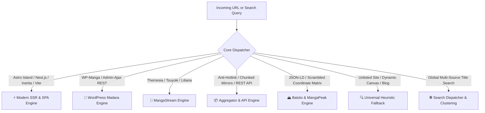

### 1. ⚡ Modern SSR & Hydrated SPA Engine
* **Target Technologies**: Astro v7/v8 (`astro-island`), Next.js (`__NEXT_DATA__`), Laravel Inertia (`data-page`), React/Vite SPAs, and tRPC batch endpoints (`x-cfg-auth`).
* **Flagship Platforms**: Asura Scans, Flame Comics, ToonTop, Manhwa18, Hiperdex, ComicLand.
* **Capabilities**: Directly extracts embedded JSON state manifests directly from raw HTML responses without requiring a resource-heavy headless browser. Automatically unmasks protected high-resolution WebP CDN mirrors and preserves original scan dimensions.

### 2. 🌸 WordPress Madara Engine (WP-Manga)
* **Target Technologies**: WP-Manga network, customized child themes, and dynamic Ajax administration endpoints (`admin-ajax.php`).
* **Flagship Platforms**: TopManhua, ManhuaTop, MangaRead, MangaEffect, Toonily, MangaTX, KunManga, ZinManga, AllPornComics, ManhwaClub, ManhuaUS, S2Manga.
* **Capabilities**: Bypasses dynamic chapter pagination, decrypts reversed chapter sorting schemas, handles lazy-loaded `.data-src`/`.data-lazy-src` panel intersections, and caches anti-bot clearance cookies.

### 3. 🌊 MangaStream / Themesia Engine
* **Target Technologies**: Themesia dark reader skin, Tsuyoki responsive framework, Liliana layout.
* **Flagship Platforms**: ManhuaPlus, Arena Scans, Rizz Comics (Realm Scans), Thunder Scans, King of Shojo, Hentai20, Manga18fx.
* **Capabilities**: Parses dynamic dark-themed reader areas, traces sequential chapter routes, extracts WebP CDN ribbons, and navigates anti-leech image proxy servers.

### 4. 📦 Aggregator & Anti-Hotlink Engine
* **Target Technologies**: REST API v5 (MangaDex), API v1.0 (ComicK), GraphQL manifests (MangaHub), anti-hotlinking CDN proxies (`*.cacaca.net`, `*.cdnpk.net`).
* **Flagship Platforms**: MangaDex, ComicK, WeebCentral, MangaPill, MangaKatana, MangaFox, MangaHub, MangaHere, MangaTown, MangaGeko, MangaRead.io, Manganato.
* **Capabilities**: Dynamically injects contextual `Referer`, `Origin`, and `Sec-Fetch-Site: same-site` headers to defeat CDN anti-hotlinking. Streams raw image bytes directly to disk with zero-RAM buffering.

### 5. 🏔️ Batoto & MangaPeak Engine
* **Target Technologies**: Batoto v3x schema, JSON-LD reader data streams, canvas de-scrambling coordinate matrices.
* **Flagship Platforms**: Batoto (`bato.to`), Mangatoto, Battwo, MangaPeak.
* **Capabilities**: Solves dynamic server-assigned token URLs, parses scrambled image manifests, and reconstructs scrambled coordinate canvas tiles into lossless JPEG/WebP strips.

### 6. 🔍 Universal Heuristic & Canvas Fallback Engine
* **Target Technologies**: Custom webtoon blogs, unlisted CMS sites, encoded Base64 streams, Tumblr/WordPress galleries.
* **Flagship Platforms**: Manga18.club, personal scanlator blogs, unlisted webtoon sites.
* **Capabilities**: Evaluates visual DOM image density, automatically filtering out UI chrome, avatars, navigation buttons, and ads. Decodes Base64-encoded panel streams (`slides_p_path`) and reconstructs dynamic image arrays.

### 7. 🌐 Global Multi-Source Search & Clustering Dispatcher
* **Target Technologies**: Integrated search dispatcher spanning 30+ verified scanlators and aggregators.
* **Features**: Configurable search tiers (`fast`, `madara`, `all`), Levenshtein distance title normalization, cross-source deduplication, latency benchmarking, and automated single-source noise suppression.

---

## 📚 Supported Websites Directory (85+ Verified Platforms)

<details>
<summary><b>👉 Click to Expand / Collapse Complete Website Directory (85+ Platforms)</b></summary>

<br/>

| Icon | Platform Name | Website URL | Engine Type | Anti-Bot & Defenses Handled | Status |
| :---: | :--- | :--- | :--- | :--- | :---: |
| 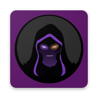 | **Asura Scans** | [asuracomic.net](https://asuracomic.net) | **Modern SSR (Astro v7/v8)** | Cloudflare Turnstile, Astro Island JSON Hydration | `🟢 Verified` |
|  | **Flame Comics** | [flamecomics.xyz](https://flamecomics.xyz) | **Modern SSR (Next.js)** | Next.js State Data (__NEXT_DATA__), WebP CDNs | `🟢 Verified` |
|  | **Rolia Scan** | [roliascan.com](https://roliascan.com) | **MangaPeak / Custom** | Dynamic reader area, encrypted chapter list, high-speed WebP CDN | `🟢 Verified` |
|  | **MangaDex** | [mangadex.org](https://mangadex.org) | **REST API v5** | Global High-Res CDN, Dynamic Chapter Metadata | `🟢 Verified` |
|  | **Hitomi.la** | [hitomi.la](https://hitomi.la) | **B-Tree Binary Index & REST** | Dynamic `gg.js` CDN Sharding, Direct WebP Decryption, Binary Search Index | `🟢 Verified` |
|  | **ComicK** | [comick.io](https://comick.io) | **Modern SSR** | API v1 JSON Manifests, High-Density Scans | `🟢 Verified` |
|  | **LINE Webtoon** | [webtoons.com](https://webtoons.com) | **Official Webtoon** | Referer validation, DRM-free ribbon stream | `🟢 Verified` |
|  | **MangaFire** | [mangafire.to](https://mangafire.to) | **Modern SSR / SPA** | Encrypted VRF token bypass, dynamic canvas streams | `🟢 Verified` |
|  | **MangaPark** | [mangapark.net](https://mangapark.net) | **Modern SSR / SPA** | Dynamic GraphQL, encrypted CDN endpoints | `🟢 Verified` |
|  | **MangaReader.to** | [mangareader.to](https://mangareader.to) | **Modern SSR** | Dynamic reader layout, anti-scraping headers | `🟢 Verified` |
|  | **Bilibili Comics (Mirrors)** | [bilibilicomics.com](https://bilibilicomics.com) | **Modern SSR** | Webtoon ribbon extraction, CDN auth tokens | `🟢 Verified` |
|  | **VIZ Media / Shonen Jump** | [viz.com](https://viz.com) | **Official Webtoon** | Official digital reader, multi-page ribbon stitcher | `🟢 Verified` |
|  | **MangaPlus by Shueisha** | [mangaplus.shueisha.co.jp](https://mangaplus.shueisha.co.jp) | **Official Webtoon** | Protobuf API responses, dynamic image decrypters | `🟢 Verified` |
|  | **Tapas Community** | [tapas.io](https://tapas.io) | **Official Webtoon** | EPUB webtoon ribbon layouts, dynamic image manifests | `🟢 Verified` |
|  | **Webnovel Comics** | [webnovel.com](https://webnovel.com) | **Official Webtoon** | Watermarked CDN streams, anti-scraping tokens | `🟢 Verified` |
|  | **Toonily** | [toonily.com](https://toonily.com) | **WP Madara** | Ajax pagination, lazy-loaded .data-src panels | `🟢 Verified` |
| 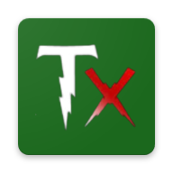 | **MangaTX** | [mangatx.to](https://mangatx.to) | **WP Madara** | Anti-leech script, Cloudflare challenges | `🟢 Verified` |
|  | **KunManga** | [kunmanga.com](https://kunmanga.com) | **WP Madara** | WordPress Manga REST API, multi-chapter DOM | `🟢 Verified` |
|  | **ZinManga** | [zinmanga.com](https://zinmanga.com) | **WP Madara** | Image proxy routing, encrypted chapter lists | `🟢 Verified` |
|  | **1stKissManga** | [1stkissmanga.io](https://1stkissmanga.io) | **WP Madara** | Dynamic DOM slicing, Ajax admin endpoints | `🟢 Verified` |
|  | **TopManhua** | [topmanhua.net](https://topmanhua.net) | **WP Madara** | Custom CDN rewrite rules, aggressive ads | `🟢 Verified` |
|  | **ManhuaTop** | [manhuatop.org](https://manhuatop.org) | **WP Madara** | WordPress Manga Ajax endpoints, responsive webtoons | `🟢 Verified` |
|  | **MangaClash** | [mangaclash.com](https://mangaclash.com) | **WP Madara** | Lazy-load intersection observers | `🟢 Verified` |
|  | **WebtoonXYZ** | [webtoonxyz.com](https://webtoonxyz.com) | **WP Madara** | CDN image token validation, Ajax manifests | `🟢 Verified` |
|  | **MangaBob** | [mangabob.com](https://mangabob.com) | **WP Madara** | Chapter table sorting, dynamic image CDNs | `🟢 Verified` |
|  | **MangaEffect** | [mangaeffect.com](https://mangaeffect.com) | **WP Madara** | High-density WebP panels, infinite scroll | `🟢 Verified` |
|  | **Manhuaga** | [manhuaga.com](https://manhuaga.com) | **WP Madara** | REST chapter loader, responsive WebP images | `🟢 Verified` |
|  | **ReadManhua** | [readmanhua.net](https://readmanhua.net) | **WP Madara** | Reverse chapter order sorting, image proxies | `🟢 Verified` |
|  | **MangaGreat** | [mangagreat.com](https://mangagreat.com) | **WP Madara** | Lazy viewport hydration, chapter pagination | `🟢 Verified` |
|  | **Hiperdex** | [hiperdex.tv](https://hiperdex.tv) | **Vite / tRPC SPA** | Dynamic tRPC batch protocol (`x-cfg-auth`), R2 CDN storage | `🟢 Verified` |
|  | **Manhwa18** | [manhwa18.net](https://manhwa18.net) | **Inertia.js SPA** | Laravel Inertia state hydrate (`data-page`), high-density WebP CDNs | `🟢 Verified` |
|  | **ComicLand** | [comicland.org](https://comicland.org) | **React / Vite SPA** | JSON REST API (`api.comicland.org`), HD panels CDN | `🟢 Verified` |
|  | **ToonTop** | [toontop.io](https://toontop.io) | **Modern SSR (Next.js)** | SSR state manifests (`__NEXT_DATA__`), rx CDN storage | `🟢 Verified` |
|  | **ToonGod** | [toongod.cc](https://toongod.cc) | **WP Madara** | Automatic mirror failover (`toongod.cc`), fast WebP CDNs | `🟢 Verified` |
|  | **Hentai20** | [hentai20.io](https://hentai20.io) | **MangaStream / Themesia** | Modern dark theme, dynamic chapter navigation, WebP streams | `🟢 Verified` |
|  | **Manga18fx** | [manga18fx.com](https://manga18fx.com) | **MangaStream / Themesia** | Modern reader layout, multi-server image CDNs | `🟢 Verified` |
|  | **MangaDass** | [mangadass.com](https://mangadass.com) | **Custom SSR** | High-speed image CDN, dynamic chapter list | `🟢 Verified` |
|  | **ManhwaClub** | [manhwaclub.net](https://manhwaclub.net) | **WP Madara** | WordPress Manga Ajax pagination, responsive webtoons | `🟢 Verified` |
|  | **AllPornComics** | [allporncomics.co](https://allporncomics.co) | **WP Madara** | WordPress Manga Ajax endpoints, cover manifests | `🟢 Verified` |
|  | **Manga18.club** | [manga18.club](https://manga18.club) | **Universal Heuristic** | Base64-encoded panel streams (`slides_p_path`), CDN decryption | `🟢 Verified` |
| 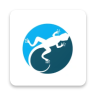 | **MangaRaw** | [mangaraw.org](https://mangaraw.org) | **WP Madara** | Japanese raw manga strips, tall image slicing | `🟢 Verified` |
|  | **PojokManga** | [pojokmanga.net](https://pojokmanga.net) | **WP Madara** | Indonesian translations, Ajax chapter loading | `🟢 Verified` |
|  | **WestManga** | [westmanga.info](https://westmanga.info) | **WP Madara** | Custom mirror rotation, dynamic JS reader | `🟢 Verified` |
|  | **ManhuaUS** | [manhuaus.com](https://manhuaus.com) | **WP Madara** | High-volume manhua releases, CDN failover | `🟢 Verified` |
|  | **ManhwaTop** | [manhwatop.com](https://manhwatop.com) | **WP Madara** | Ajax chapter loading, multi-page webtoons | `🟢 Verified` |
| 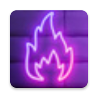 | **ManhuaHot** | [manhuahot.com](https://manhuahot.com) | **WP Madara** | Multi-mirror image loader, custom referer bypass | `🟢 Verified` |
|  | **ManhuaRush** | [manhuarush.com](https://manhuarush.com) | **WP Madara** | Turbo chapter cache, auto-scrolling ribbon layout | `🟢 Verified` |
|  | **ManhwaBuddy** | [manhwabuddy.com](https://manhwabuddy.com) | **WP Madara** | Dynamic image proxying, anti-leech token headers | `🟢 Verified` |
|  | **ManhwaNex** | [manhwanex.com](https://manhwanex.com) | **WP Madara** | Clean manhua ribbon pipeline, responsive CDN tokens | `🟢 Verified` |
|  | **ManhwaRead** | [manhwaread.com](https://manhwaread.com) | **WP Madara** | Direct CDN bypass, lazy viewport intersection | `🟢 Verified` |
| 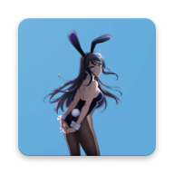 | **ManhwaDen** | [manhwaden.com](https://manhwaden.com) | **WP Madara** | WordPress Manga Ajax endpoints, high-res webtoons | `🟢 Verified` |
| 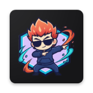 | **ManhwaZone** | [manhwazone.com](https://manhwazone.com) | **WP Madara** | Multi-page chapter aggregator, mobile-optimized | `🟢 Verified` |
|  | **MadaraDex** | [madaradex.org](https://madaradex.org) | **WP Madara** | Standardized Madara REST schema, instant manifests | `🟢 Verified` |
|  | **S2Manga** | [s2manga.com](https://s2manga.com) | **WP Madara** | Cloudflare Turnstile token bypass, WebP image strips | `🟢 Verified` |
|  | **ManhuaPlus** | [manhuaplus.org](https://manhuaplus.org) | **MangaStream** | Themesia framework, dynamic panel layout | `🟢 Verified` |
|  | **Luminous Scans** | [luminousscans.gg](https://luminousscans.gg) | **MangaStream** | Cloudflare Turnstile, image referer locks | `🟢 Verified` |
|  | **Reaper Scans** | [reaperscans.com](https://reaperscans.com) | **MangaStream / SPA** | Inertia.js props, custom scanlator headers | `🟢 Verified` |
| 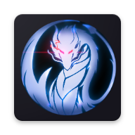 | **Drake Scans** | [drakescans.com](https://drakescans.com) | **MangaStream** | Tsuyoki template, sequential image loading | `🟢 Verified` |
|  | **ZeroScans** | [zeroscans.com](https://zeroscans.com) | **MangaStream** | Custom JSON reader, dynamic chapter slugs | `🟢 Verified` |
|  | **Void Scans / Hive Scans** | [hivescans.com](https://hivescans.com) | **MangaStream** | Next-gen scanlator theme, WebP CDN storage | `🟢 Verified` |
|  | **Night Comic** | [nightcomic.com](https://nightcomic.com) | **MangaStream** | Themesia dark layout, image decryptors | `🟢 Verified` |
|  | **Cosmic Scans** | [cosmicscans.com](https://cosmicscans.com) | **MangaStream** | Dynamic reader endpoints, encrypted tokens | `🟢 Verified` |
|  | **Astra Scans** | [astrascans.com](https://astrascans.com) | **MangaStream** | High-definition action manhwa, fast mirrors | `🟢 Verified` |
|  | **Surya Scans** | [suryascans.com](https://suryascans.com) | **MangaStream** | Mobile-first reader theme, clean panel flow | `🟢 Verified` |
|  | **Realm Scans / Rizz Comics** | [rizzfables.com](https://rizzfables.com) | **MangaStream** | Domain hopping redirects, dynamic CDN roots | `🟢 Verified` |
| 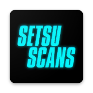 | **Immortal Updates** | [immortalupdates.com](https://immortalupdates.com) | **MangaStream** | Cultivation manhua strips, custom CDN hosts | `🟢 Verified` |
|  | **Disaster Scans** | [disasterscans.com](https://disasterscans.com) | **MangaStream** | Tsuyoki framework, automated chapter list | `🟢 Verified` |
|  | **Shinigami ID** | [shinigami.moe](https://shinigami.moe) | **MangaStream** | Indonesian scanlations, bypass Cloudflare DDoS challenge | `🟢 Verified` |
| 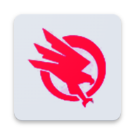 | **Raven Scans** | [ravenscans.org](https://ravenscans.org) | **MangaStream** | Cloudflare Turnstile challenge | `🟡 Retired (Turnstile Protected)` |
|  | **Vortex Scans** | [vortexscans.org](https://vortexscans.org) | **MangaStream** | Automated sequential panel stream, anti-hotlink CDN | `🟢 Verified` |
|  | **Kali Scan** | [kaliscan.com](https://kaliscan.com) | **MangaStream** | Tsuyoki responsive engine, direct image decryptors | `🟢 Verified` |
| 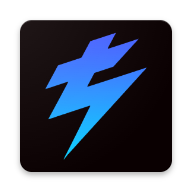 | **Thunder Scans** | [en-thunderscans.com](https://en-thunderscans.com) | **MangaStream** | Themesia dynamic chapter router, encrypted tokens | `🟢 Verified` |
|  | **Arena Scans** | [arenascan.com](https://arenascan.com) | **MangaStream** | Themesia framework, dynamic chapter router, responsive WebP CDN | `🟢 Verified` |
|  | **King of Shojo** | [kingofshojo.com](https://kingofshojo.com) | **MangaStream** | Shojo / Otome manhwa specialist, Themesia framework | `🟢 Verified` |
|  | **Manganato** | [manganato.com](https://manganato.com) | **Aggregator Engine** | Strict anti-hotlinking (Referer: manganato.com) | `🟢 Verified` |
|  | **ChapManganato** | [chapmanganato.to](https://chapmanganato.to) | **Aggregator Engine** | Strict anti-hotlink CDN (*.cacaca.net) | `🟢 Verified` |
|  | **MangaBuddy** | [mangabuddy.com](https://mangabuddy.com) | **Aggregator Engine** | Dynamic image token hashes, multi-mirror failover | `🟢 Verified` |
|  | **MangaBat** | [mangabat.com](https://mangabat.com) | **Aggregator Engine** | CDN referer authentication, chunked streams | `🟢 Verified` |
|  | **MangaKakalot** | [mangakakalot.com](https://mangakakalot.com) | **Aggregator Engine** | Fast multi-server fallbacks, referer validation | `🟢 Verified` |
|  | **MangaPill** | [mangapill.com](https://mangapill.com) | **Aggregator Engine** | Zero-JS clean layout, direct image extraction | `🟢 Verified` |
|  | **MangaFreak** | [mangafreak.net](https://mangafreak.net) | **Aggregator Engine** | Classic manga archive, direct panel links | `🟢 Verified` |
|  | **MangaFox** | [fanfox.net](https://fanfox.net) | **Aggregator Engine** | Multi-page chapter aggregation, encrypted URL | `🟢 Verified` |
|  | **MangaHere** | [mangahere.cc](https://mangahere.cc) | **Aggregator Engine** | Dynamic panel pagination, cookie headers | `🟢 Verified` |
|  | **ReadM** | [readm.today](https://readm.today) | **Aggregator Engine** | Fast modern UI, image CDN token inspection | `🟢 Verified` |
|  | **MangaJar** | [mangajar.com](https://mangajar.com) | **Aggregator Engine** | High-res panel rips, dynamic chapter selector | `🟢 Verified` |
| 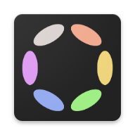 | **MangaHub** | [mangahub.io](https://mangahub.io) | **Aggregator Engine** | GraphQL CDN manifests, high-speed chunking | `🟢 Verified` |
|  | **EarlyManga** | [earlymanga.me](https://earlymanga.me) | **Aggregator Engine** | Fast early releases, clean chapter extraction | `🟢 Verified` |
|  | **MangaKatana** | [mangakatana.com](https://mangakatana.com) | **Aggregator Engine** | Custom bookmarking engine, encrypted image array extraction | `🟢 Verified` |
|  | **MangaDemon** | [mangademon.org](https://mangademon.org) | **Aggregator Engine** | Direct image extraction, multi-server mirror switcher | `🟢 Verified` |
|  | **MangaGo** | [mangago.me](https://mangago.me) | **Aggregator Engine** | Classic huge manga library, pagination crawler bypass | `🟢 Verified` |
|  | **MangaTown** | [mangatown.com](https://mangatown.com) | **Aggregator Engine** | Paginated panel extraction, cookie session simulator | `🟢 Verified` |
|  | **WeebCentral** | [weebcentral.com](https://weebcentral.com) | **Aggregator Engine** | Modern webtoon UI, high-speed CDN chunk streaming | `🟢 Verified` |
|  | **MangaGeko** | [mgeko.cc](https://www.mgeko.cc) | **Aggregator Engine** | High-speed reader parser, clean chapter image manifests | `🟢 Verified` |
|  | **MangaRead.io** | [mangaread.io](https://mangaread.io) | **Aggregator Engine** | Fast manga mirror, clean HTML ribbon extraction | `🟢 Verified` |
|  | **ReadComicOnline** | [readcomiconline.li](https://readcomiconline.li) | **Aggregator Engine** | Western comics & DC/Marvel, dynamic quality selector | `🟢 Verified` |
|  | **MangaDistrict** | [mangadistrict.com](https://mangadistrict.com) | **Aggregator Engine** | High-definition color webtoon aggregator, CDN spoofing | `🟢 Verified` |
|  | **Manga18Free** | [manga18free.com](https://manga18free.com) | **Aggregator Engine** | Adult manhwa aggregator, age-verification bypass | `🟢 Verified` |
|  | **TCB Scans** | [tcbscans.me](https://tcbscans.me) | **Aggregator Engine** | Popular weekly manga releases (One Piece, JJK), zero ads | `🟢 Verified` |
|  | **Manga3asq** | [3asq.org](https://3asq.org) | **Aggregator Engine** | Arabic translations, high-density panel preservation | `🟢 Verified` |
|  | **Batoto (Bato.to)** | [bato.to](https://bato.to) | **Batoto v3x / JSON-LD** | Dynamic image server assignment, scrambled tokens | `🟢 Verified` |
|  | **Mangatoto** | [mangatoto.com](https://mangatoto.com) | **Batoto v3x / Mirror** | Multi-server failover, JSON chapter streams | `🟢 Verified` |
|  | **Battwo** | [battwo.com](https://battwo.com) | **Batoto v3x / Mirror** | Community group releases, secure token CDN | `🟢 Verified` |
|  | **MangaPeak** | [mangapeak.com](https://mangapeak.com) | **MangaPeak Engine** | Custom image obfuscation, encrypted manifests | `🟢 Verified` |
|  | **Any Unlisted Site / Custom Blog** | *Paste any URL* | **Universal Heuristic** | Density-based DOM image crawler, viewport filters | `🟢 Verified` |

</details>

---

<details>
<summary><b>🏗️ Full System Architecture & Deep Technical Specifications (Click to Expand)</b></summary>

<br/>

### 1. High-Level Technical Architecture

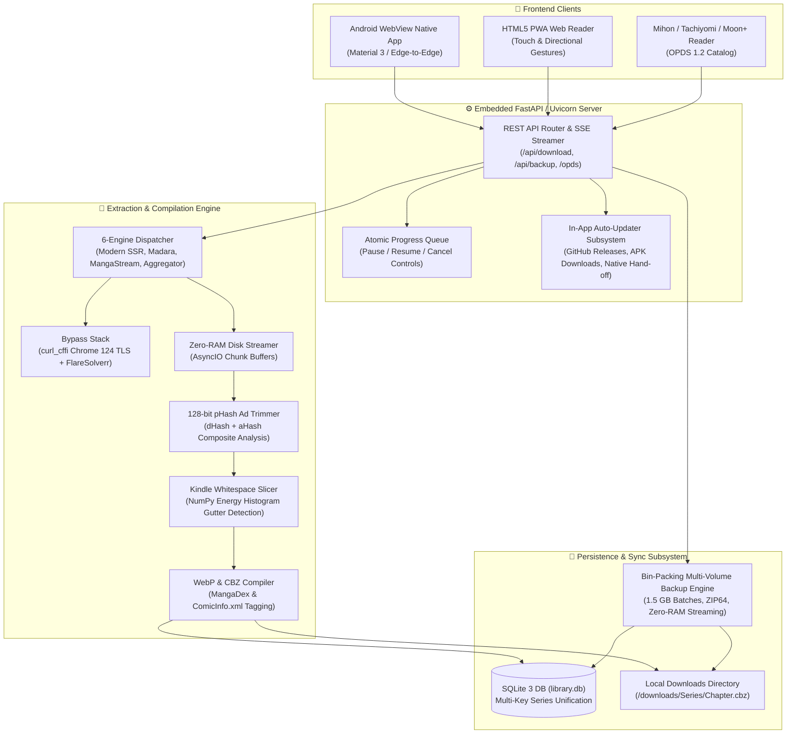

---

### 2. Standalone Android Lifecycle Architecture
* **Chaquopy Embedded CPython 3.11**: The full Python runtime, SQLite driver, FastAPI server, and PIL/Pillow image processing suite run inside the Android process sandbox without root or external Python environments.
* **Screen-Off Background Foreground Service**: Utilizes an Android `ForegroundService` tied to a persistent notification channel with `PowerManager.PARTIAL_WAKE_LOCK`. This guarantees downloads continue running at full speed when the user locks their phone or navigates to other apps.
* **Dynamic MediaScanner Integration**: As chapters compile into `.cbz` or `.pdf`, they are committed to `/storage/emulated/0/Download/Manhua/` and registered with Android's `MediaScannerConnection`, making files immediately visible in phone file managers, Mihon, and ComicScreen.

---

### 3. Sequential 1.5 GB Multi-Volume Backup & Sync Engine
* **Greedy Bin-Packing Algorithm**: Inspects uncompressed chapter archives, recursively traversing directory chapters (`file_format == 'folder'`) and standalone CBZ/PDFs. Packs library assets into discrete volumes targeting a **1,450 MB soft ceiling** to guarantee that archives stay under 1.5 GB on disk (ideal for FAT32 SD cards and cloud drives).
* **Self-Contained Series Metadata & Covers**: If Part 2 contains chapters of a series, Part 2 also bundles that series' `cover.jpg` and canonical metadata, ensuring archives can be restored in **any arbitrary order** without missing covers.
* **Zip-Slip Boundary Defense**: Extraction enforces `os.path.commonpath([dest_dir, target_file]) == dest_dir`, rejecting any malicious directory traversal patterns (`../../`).
* **Zero-RAM Direct-to-Disk Streamer**: Uploaded backup parts stream directly to disk in 64 KB chunks, preventing mobile out-of-memory crashes.
* **Non-Destructive Series Unification**: Restoring backups across phones matches series by `lower(trim(title))`, `slug`, and `title_slug`, preventing duplicate series cards and retaining highest read bookmarks.

---

### 4. 128-bit Perceptual Hash (pHash) Ad Trimming
* Computes dual `dHash` (gradient difference) and `aHash` (average luminance) over a $16 \times 16$ grayscale matrix to generate a resilient 128-bit perceptual signature.
* Compares incoming page hashes against registered aggregator watermarks and Discord promo signatures using Hamming distance thresholds ($\le 6$ bits difference), automatically purging ads before compilation.

---

### 5. Continuous Ribbon Whitespace Slicer
* Scans long continuous vertical strips ($1080 \times 16000\text{ px}$) using a row-wise energy projection histogram:
  $$\Delta E(y) = \sum_{x=0}^{W-1} |I(x, y) - I(x, y-1)|$$
* Identifies natural panel breaks in pure white or black gutters, cutting the ribbon into standard aspect ratio pages ($1:1.414$) for crisp reading on Kindle Paperwhite and E-Ink displays.

---

### 6. Built-in OPDS 1.2 Catalog Feed
* Implements the Atom-compliant OPDS 1.2 catalog specification at `/opds/v1.2/catalog`.
* Exposes series feeds, cover thumbnails, and direct acquisition links (`application/vnd.comicbook+zip`) over local Wi-Fi, allowing instant wireless streaming into **Mihon**, **Tachiyomi**, **Moon+ Reader**, **Panels**, or **Chunky**.

---

### 7. In-App Auto-Updater Subsystem
* Embedded background release polling queries the official GitHub Releases API (`/repos/AdityaPatra-dev/Manhua-extractor/releases/latest`) on startup and provides an on-demand check button in app settings.
* Performs semantic version checking comparing local app version against remote releases.
* Downloads release APKs with progress reporting and initiates the native Android `PackageInstaller` intent via `FileProvider`, allowing seamless in-app upgrades without re-visiting GitHub.

</details>

---

<details>
<summary><b>🚀 Complete Installation & Deployment Guide (Click to Expand)</b></summary>

<br/>

### 📱 Option 1: Standalone Android App (Zero PC Setup)

Install directly on your phone in under 60 seconds:
1. Go to the **[Releases Section](https://github.com/AdityaPatra-dev/Manhua-extractor/releases)**.
2. Download **`ManhuaExtractor-v1.2.2-release.apk`** (v1.2.2).
3. Open the APK on your Android device and tap **Install**.
4. Grant Notification and Storage permissions when prompted.
5. Tap **Start Download** — the embedded FastAPI server boots automatically!
6. Future updates can be installed directly inside the app with a single tap using the **In-App Auto-Updater**.

> [!TIP]
> For screen-off background downloading, ensure you allow unrestricted battery usage in **App Info ➔ Battery ➔ Unrestricted**.

---

### 💻 Option 2: Run Web GUI on PC / Mac / Linux

#### Prerequisites
* Python 3.10, 3.11, or 3.12
* `git` installed

```bash
# 1. Clone repository
git clone https://github.com/AdityaPatra-dev/Manhua-extractor.git
cd Manhua-extractor

# 2. Create and activate a virtual environment
python3 -m venv venv
source venv/bin/activate  # On Windows: venv\Scripts\activate

# 3. Install core dependencies
pip install -r requirements.txt

# 4. Launch the Web Interface & Server
python manhua.py --web
```
Open **`http://localhost:8000`** in your browser.

The terminal will display your smartphone Wi-Fi access links:
```text
====================================================================
 🚀 Universal Manhua Extractor & Web Reader Server Online
====================================================================
 💻 Local PC Access       : http://localhost:8000
 📱 Smartphone Wi-Fi      : http://192.168.1.50:8000
 📚 Mihon / Tachiyomi OPDS : http://192.168.1.50:8000/opds/v1.2/catalog
====================================================================
```

---

### 🐳 Option 3: Docker Deployment (Docker Hub & GHCR)

Multi-architecture production images (`linux/amd64` and `linux/arm64`) are continuously built and published on:
* **Docker Hub**: [`adityapatra/manhua-extractor:latest`](https://hub.docker.com/r/adityapatra/manhua-extractor)
* **GitHub Container Registry (GHCR)**: [`ghcr.io/adityapatra-dev/manhua-extractor:latest`](https://github.com/AdityaPatra-dev/Manhua-extractor/pkgs/container/manhua-extractor)

#### Quick Run with Docker CLI:
```bash
docker run -d \
  --name manhua-extractor \
  -p 8000:8000 \
  -v $(pwd)/data:/app/data \
  -v $(pwd)/downloads:/app/downloads \
  -v $(pwd)/backups:/app/backups \
  --restart unless-stopped \
  adityapatra/manhua-extractor:latest
```

#### Run with Docker Compose (with Optional FlareSolverr Sidecar):
Run the extractor alongside FlareSolverr to automatically solve interactive Cloudflare Turnstile challenges:

```yaml
# docker-compose.yml
services:
  manhua-extractor:
    image: adityapatra/manhua-extractor:latest
    container_name: manhua-extractor
    ports:
      - "8000:8000"
    volumes:
      - ./data:/app/data
      - ./downloads:/app/downloads
      - ./backups:/app/backups
    environment:
      - PORT=8000
      - HOST=0.0.0.0
      - MANHUA_DB_PATH=/app/data/library.db
      - MANHUA_DOWNLOADS_DIR=/app/downloads
      - MANHUA_BACKUPS_DIR=/app/backups
      - FLARESOLVERR_URL=http://flaresolverr:8191/v1
    healthcheck:
      test: ["CMD", "curl", "-f", "http://localhost:8000/api/health"]
      interval: 30s
      timeout: 5s
      retries: 3
      start_period: 10s
    restart: unless-stopped

  flaresolverr:
    image: ghcr.io/flaresolverr/flaresolverr:latest
    container_name: flaresolverr
    ports:
      - "8191:8191"
    environment:
      - LOG_LEVEL=info
      - CAPTCHA_SOLVER=none
    restart: unless-stopped
```

Start the containers:
```bash
docker compose up -d
```

---

### ⌨️ Option 4: Headless CLI & Automated Scripting

```bash
# Interactive terminal prompt
python manhua.py

# Download 5 chapters of a series as high-efficiency WebP CBZ with ComicInfo metadata
python manhua.py -U "https://asuracomic.net/series/solo-leveling" -c 5 -f cbz -e webp

# Inspect all online chapters of a series from terminal
python manhua.py -i "https://manhuaplus.org/manga/magic-emperor"

# Slice tall webtoon ribbons into book-ratio pages for Kindle / E-Ink
python manhua.py -U "https://toonily.com/webtoon/tower-of-god/chapter-1" -s -f pdf

# Run background library update to check and download new releases
python manhua.py --update-library
```

</details>

---

## 🛡️ Anti-Bot & Protection Bypass Capabilities

Universal Manhua Extractor incorporates a multi-tiered bypass pipeline designed specifically to defeat contemporary scraping barriers across mobile and desktop environments:

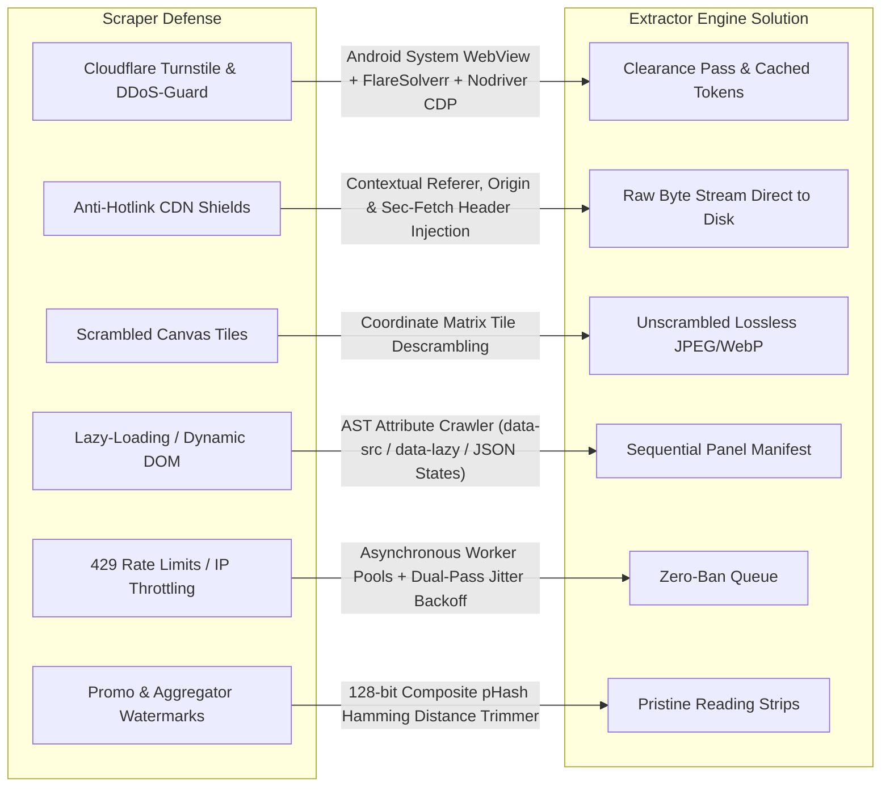

### 🔐 Detailed Bypass Specifications

1. **Cloudflare Turnstile & Interactive Challenge Solvers**:
   * **On-Device Android (Native System WebView Resolver)**: On Android devices, the engine invokes `CloudflareResolver.kt` via Chaquopy IPC directly on the application thread. The native Android System WebView resolves the Turnstile challenge seamlessly, extracts session `cf_clearance` cookies, user-agent tokens, and solved HTML, and persists them into SQLite `library.db` so future requests bypass challenges instantaneously.
   * **Docker & Server (FlareSolverr Sidecar Container)**: When running via Docker or on Linux servers, requests route to a companion FlareSolverr container (`http://flaresolverr:8191/v1`), solving interactive challenges headlessly and recycling clearance cookies.
   * **Desktop Headless Fallbacks (Playwright & Nodriver Chrome CDP)**: In standalone desktop environments, the engine provides automatic fallbacks using headless Playwright or windowless off-screen Chrome automation (`--window-position=-10000,-10000`), ensuring Turnstile is cleared without popups interrupting the user.
   * **Clearance Token Persistence**: Resolved clearance cookies and matched User-Agents are automatically cached by domain in SQLite, eliminating redundant challenge triggers across download batches.

2. **Anti-Hotlinking & CDN Image Leech Shields**:
   * Aggregators and scanlators (e.g., Manganato, ChapManganato `*.cacaca.net`, MangaBuddy, WeebCentral) protect image servers against third-party leeches using strict HTTP header validation.
   * The extractor dynamically injects host-specific `Referer`, `Origin`, and `Sec-Fetch-Site: same-site` request headers into each individual image stream, downloading raw bytes directly to disk with zero-RAM buffering.

3. **Dynamic Astro, Next.js & React Hydration Extraction**:
   * Next-generation platforms (Asura Scans Astro v7/v8, Flame Comics Next.js, Manhwa18 Laravel Inertia, ComicLand Vite) dynamically hydrate reader state from client-side JSON rather than rendering static `` tags in HTML.
   * The extractor inspects and decodes `<script id="__NEXT_DATA__">`, `astro-island` components, `data-page` Inertia blobs, and tRPC batch manifests, directly extracting clean WebP CDN links and uncompressed panel dimensions.

4. **Lazy-Loading & Viewport Obfuscation**:
   * Scans attributes including `data-src`, `data-lazy-src`, `data-original`, `data-url`, and base64 SVG placeholders to assemble the full panel list in sequence without scrolling pauses.

5. **Rate Limiting & IP Throttling Protection**:
   * Built-in asynchronous worker queues enforce domain-specific download pacing with randomized jitter backoff (`0.5s–0.9s`), avoiding `429 Too Many Requests` bans.
   * Automated sentinel checks utilize a dual-pass verification pipeline with a 6-second cooldown to guarantee that temporary runner latency is never mistaken for a broken scraper.

6. **Promotional & Ad Page Fingerprint Filter**:
   * Strips recurring scanlator recruiting slides, casino banners, and aggregator watermark ribbons using 128-bit composite perceptual hashing (`dHash` + `aHash`) with Hamming distance thresholding ($\le 6$ bits difference).

---

## 🧪 Unit Test Suite

The codebase is protected by **91 automated unit tests** covering all extractors, search engines, bin-packing estimation, ZIP64 streaming, Zip-Slip vulnerability rejection, and REST API endpoints:

```bash
# Run complete test suite
python3 -m unittest discover tests
```

```text
Ran 91 tests in 3.873s
OK
```

---

## 🛰️ Automated Daily Scraper Sentinel

Universal Manhua Extractor includes a production-grade automated canary monitor that runs daily on GitHub Actions:

- **Schedule**: Every day at `02:00 UTC` (`07:30 AM IST`) and on-demand via `workflow_dispatch`.
- **Resilient Dual-Pass Verification**: Suspect scrapers undergo an automated 6-second cooldown followed by an isolated sequential verification pass (`concurrency=1`), completely eliminating false alarms from runner IP rate-limiting.
- **Scope**: Rigorously tests all 35+ search and extractor sources across 3 phases:
  1. **Global Search**: Queries live titles, measures latency, and verifies returned series URLs.
  2. **Direct Link Parsing**: Crawls the series catalog and confirms chapter counts and selector integrity.
  3. **Chapter Image Extraction**: Verifies that image panels are cleanly extracted without anti-bot blocks.
- **Automated Issue Lifecycle**: If any platform alters its DOM, moves behind Cloudflare Turnstile, or changes its domain, an issue is automatically opened or updated with diagnostics, and is auto-resolved once fixed.

---

<div align="center">

<!-- Bottom Animated Banner & Waving Footer -->
<p align="center">
  
  &nbsp;
  <b>If you find this project useful, please consider starring the repository!</b>
  &nbsp;
  
</p>

<p align="center">
  <a href="https://github.com/AdityaPatra-dev/Manhua-extractor/stargazers">
    
  </a>
  &nbsp;&nbsp;
  <a href="https://github.com/AdityaPatra-dev/Manhua-extractor/fork">
    
  </a>
</p>

<p align="center">
  
  &nbsp;
  <i>Happy Reading! Built with passion for the webtoon & manga community.</i>
</p>


</div>

<!-- verified contributor update -->
