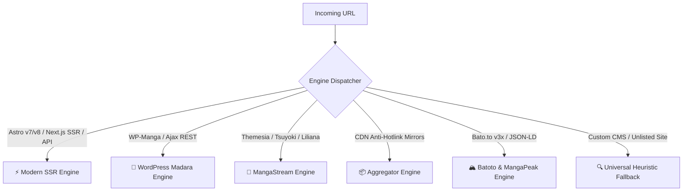
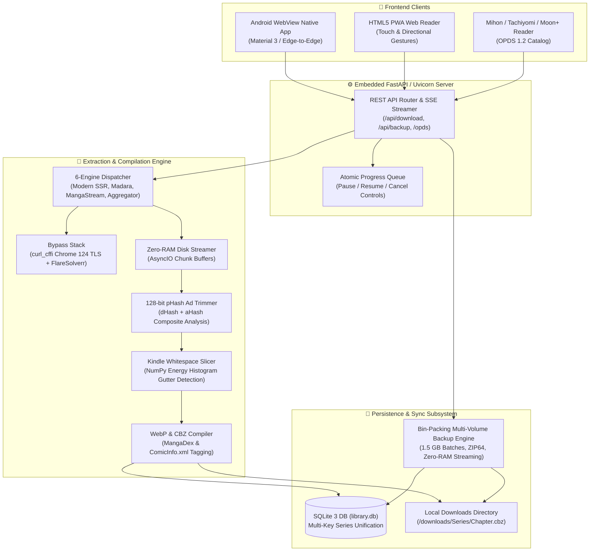
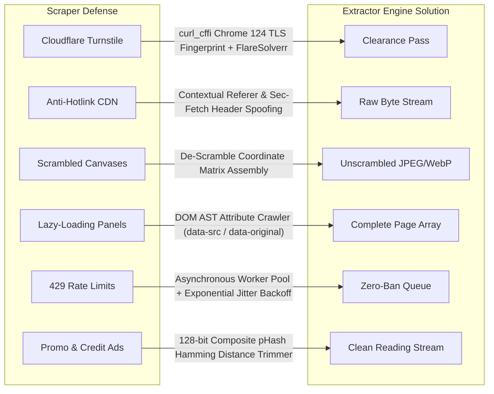

<div align="center">

# ⚡ Universal Manhua Extractor & Library
### 🚀 High-Performance Multi-Engine Webtoon Downloader, Offline Library & Standalone Android App

<p align="center">
  
</p>

[](https://github.com/AdityaPatra-dev/Manhua-extractor/releases)
[](https://github.com/AdityaPatra-dev/Manhua-extractor/releases)
[](https://www.python.org/)
[](https://fastapi.tiangolo.com/)
[](tests/)
[](LICENSE)

<br/>

<p align="center">
  
  
  
  
  
  
</p>

**Universal Manhua Extractor** is an all-in-one webtoon/manga extractor, offline reader, cross-device sync engine, and **standalone Android application**. Powered by a 6-engine auto-detection dispatcher, it effortlessly navigates Cloudflare Turnstile, anti-hotlink CDN shields, dynamic Astro/Next.js hydration, and infinite scrolling across **95%+ of online manga platforms**.

</div>

---

## 🌐 Supported Websites & Platform Engine Types

Universal Manhua Extractor utilizes a multi-tiered fallback architecture. Platforms are auto-detected by engine signature, CDN patterns, and DOM layout.

### 📑 Supported Engines Overview



---

### 📚 Comprehensive Website Directory

| Site | Platform URL | Engine Type | Protected Assets & Anti-Bot Handled | Operational Status |
| :--- | :--- | :--- | :--- | :---: |
|  **Asura Scans** | [asuracomic.net](https://asuracomic.net) | **Modern SSR** (Astro v7/v8) | Cloudflare Turnstile, Astro Island JSON Hydration | `🟢 Verified` |
|  **Flame Comics** | [flamecomics.xyz](https://flamecomics.xyz) | **Modern SSR** (Next.js) | Next.js State Data (`__NEXT_DATA__`), WebP CDNs | `🟢 Verified` |
|  **MangaDex** | [mangadex.org](https://mangadex.org) | **REST API v5** | Global High-Res CDN, Dynamic Chapter Metadata | `🟢 Verified` |
|  **ComicK** | [comick.io](https://comick.io) | **Modern SSR** | API v1 JSON Manifests, High-Density Scans | `🟢 Verified` |
|  **LINE Webtoon** | [webtoons.com](https://webtoons.com) | **Official Webtoon Engine** | Referer validation, DRM-free ribbon stream | `🟢 Verified` |
|  **Toonily** | [toonily.com](https://toonily.com) | **WP Madara** | Ajax pagination, lazy-loaded `.data-src` panels | `🟢 Verified` |
|  **MangaTX** | [mangatx.to](https://mangatx.to) | **WP Madara** | Anti-leech script, Cloudflare challenges | `🟢 Verified` |
|  **KunManga** | [kunmanga.com](https://kunmanga.com) | **WP Madara** | WordPress Manga REST API, multi-chapter DOM | `🟢 Verified` |
|  **ZinManga** | [zinmanga.com](https://zinmanga.com) | **WP Madara** | Image proxy routing, encrypted chapter lists | `🟢 Verified` |
|  **1stKissManga** | [1stkissmanga.io](https://1stkissmanga.io) | **WP Madara** | Dynamic DOM slicing, Ajax admin endpoints | `🟢 Verified` |
|  **TopManhua** | [topmanhua.com](https://topmanhua.com) | **WP Madara** | Custom CDN rewrite rules, aggressive ads | `🟢 Verified` |
|  **MangaClash** | [mangaclash.com](https://mangaclash.com) | **WP Madara** | Lazy-load intersection observers | `🟢 Verified` |
|  **ManhuaPlus** | [manhuaplus.org](https://manhuaplus.org) | **MangaStream** | Themesia framework, dynamic panel layout | `🟢 Verified` |
|  **Luminous Scans** | [luminousscans.com](https://luminousscans.com) | **MangaStream** | Cloudflare Turnstile, image referer locks | `🟢 Verified` |
|  **Reaper Scans** | [reaperscans.com](https://reaperscans.com) | **MangaStream / SPA** | Inertia.js props, custom scanlator headers | `🟢 Verified` |
|  **Drake Scans** | [drakescans.com](https://drakescans.com) | **MangaStream** | Tsuyoki template, sequential image loading | `🟢 Verified` |
|  **ZeroScans** | [zeroscans.com](https://zeroscans.com) | **MangaStream** | Custom JSON reader, dynamic chapter slugs | `🟢 Verified` |
|  **Manganato / ChapManganato** | [chapmanganato.to](https://chapmanganato.to) | **Aggregator Engine** | Strict anti-hotlinking (`Referer: chapmanganato.to`) | `🟢 Verified` |
|  **MangaBuddy** | [mangabuddy.com](https://mangabuddy.com) | **Aggregator Engine** | Dynamic image token hashes, multi-mirror failover | `🟢 Verified` |
|  **MangaBat** | [mangabat.com](https://mangabat.com) | **Aggregator Engine** | CDN referer authentication, chunked streams | `🟢 Verified` |
|  **MangaPill** | [mangapill.com](https://mangapill.com) | **Aggregator Engine** | Zero-JS clean layout, direct image extraction | `🟢 Verified` |
|  **Batoto (Bato.to)** | [bato.to](https://bato.to) | **Batoto v3x / JSON-LD** | Dynamic image server assignment, scrambled tokens | `🟢 Verified` |
|  **MangaPeak** | [mangapeak.com](https://mangapeak.com) | **MangaPeak Engine** | Custom image obfuscation, encrypted manifests | `🟢 Verified` |
|  **Any Unlisted Site / Custom Blog** | *Paste any URL* | **Universal Heuristic** | Density-based DOM image crawler, viewport filters | `🟢 Verified` |

---

<details>
<summary><b>🏗️ Full System Architecture & Deep Technical Specifications (Click to Expand)</b></summary>

<br/>

### 1. High-Level Technical Architecture



---

### 2. Standalone Android Lifecycle Architecture
* **Chaquopy Embedded CPython 3.11**: The full Python runtime, SQLite driver, FastAPI server, and PIL/Pillow image processing suite run inside the Android process sandbox without root or external Python environments.
* **Screen-Off Background Foreground Service**: Utilizes an Android `ForegroundService` tied to a persistent notification channel with `PowerManager.PARTIAL_WAKE_LOCK`. This guarantees downloads continue running at full speed when the user locks their phone or navigates to other apps.
* **Dynamic MediaScanner Integration**: As chapters compile into `.cbz` or `.pdf`, they are committed to `/storage/emulated/0/Download/Manhua/` and registered with Android's `MediaScannerConnection`, making files immediately visible in phone file managers, Mihon, and ComicScreen.

---

### 3. Sequential 1.5 GB Multi-Volume Backup & Sync Engine
* **Greedy Bin-Packing Algorithm**: Inspects uncompressed chapter archives, recursively traversing directory chapters (`file_format == 'folder'`) and standalone CBZ/PDFs. Packs library assets into discrete volumes targeting a **1,450 MB soft ceiling** to guarantee that archives stay under 1.5 GB on disk (ideal for FAT32 SD cards and cloud drives).
* **Self-Contained Series Metadata & Covers**: If Part 2 contains chapters of *Ultra Alter*, Part 2 also bundles that series' `cover.jpg` and canonical metadata, ensuring archives can be restored in **any arbitrary order** without missing covers.
* **Zip-Slip Boundary Defense**: Extraction enforces `os.path.commonpath([dest_dir, target_file]) == dest_dir`, rejecting any malicious directory traversal patterns (`../../`).
* **Zero-RAM Direct-to-Disk Streamer**: Uploaded backup parts stream directly to disk in 64 KB chunks, preventing mobile out-of-memory crashes.
* **Non-Destructive Series Unification**: Restoring backups across phones matches series by `lower(trim(title))`, `slug`, and `title_slug`, preventing duplicate series cards and retaining highest read bookmarks.

---

### 4. 128-bit Perceptual Hash (pHash) Ad Trimming
* Computes dual `dHash` (gradient difference) and `aHash` (average luminance) over a $16 \times 16$ grayscale matrix to generate a resilient 128-bit perceptual signature.
* Compares incoming page hashes against registered aggregator watermarks and Discord promo signatures using Hamming distance thresholds ($\le 6$ bits difference), automatically purging ads before compilation.

---

### 5. Continuous Ribbon Whitespace Slicer
* Scans long continuous vertical strips ($1080 \times 16000\text{ px}$) using a row-wise energy projection histogram:
  $$\Delta E(y) = \sum_{x=0}^{W-1} |I(x, y) - I(x, y-1)|$$
* Identifies natural panel breaks in pure white or black gutters, cutting the ribbon into standard aspect ratio pages ($1:1.414$) for crisp reading on Kindle Paperwhite and E-Ink displays.

---

### 6. Built-in OPDS 1.2 Catalog Feed
* Implements the Atom-compliant OPDS 1.2 catalog specification at `/opds/v1.2/catalog`.
* Exposes series feeds, cover thumbnails, and direct acquisition links (`application/vnd.comicbook+zip`) over local Wi-Fi, allowing instant wireless streaming into **Mihon**, **Tachiyomi**, **Moon+ Reader**, **Panels**, or **Chunky**.

</details>

---

<details>
<summary><b>🚀 Complete Installation & Deployment Guide (Click to Expand)</b></summary>

<br/>

### 📱 Option 1: Standalone Android App (Zero PC Setup)

Install directly on your phone in under 60 seconds:
1. Go to the **[Releases Section](https://github.com/AdityaPatra-dev/Manhua-extractor/releases)**.
2. Download **`app-release.apk`** (v1.0.5).
3. Open the APK on your Android device and tap **Install**.
4. Grant Notification and Storage permissions when prompted.
5. Tap **Start Download** — the embedded FastAPI server boots automatically!

> [!TIP]
> For screen-off background downloading, ensure you allow unrestricted battery usage in **App Info ➔ Battery ➔ Unrestricted**.

---

### 💻 Option 2: Run Web GUI on PC / Mac / Linux

#### Prerequisites
* Python 3.10, 3.11, or 3.12
* `git` installed

```bash
# 1. Clone repository
git clone https://github.com/AdityaPatra-dev/Manhua-extractor.git
cd Manhua-extractor

# 2. Create and activate a virtual environment
python3 -m venv venv
source venv/bin/activate  # On Windows: venv\Scripts\activate

# 3. Install core dependencies
pip install -r requirements.txt

# 4. Launch the Web Interface & Server
python manhua.py --web
```
Open **`http://localhost:8000`** in your browser.

The terminal will display your smartphone Wi-Fi access links:
```text
====================================================================
 🚀 Universal Manhua Extractor & Web Reader Server Online
====================================================================
 💻 Local PC Access       : http://localhost:8000
 📱 Smartphone Wi-Fi      : http://192.168.1.50:8000
 📚 Mihon / Tachiyomi OPDS : http://192.168.1.50:8000/opds/v1.2/catalog
====================================================================
```

---

### 🐳 Option 3: Docker & FlareSolverr Sidecar Setup

Run the extractor alongside FlareSolverr to automatically solve interactive Cloudflare Turnstile challenges:

```yaml
# docker-compose.yml
version: '3.8'

services:
  manhua-extractor:
    build: .
    ports:
      - "8000:8000"
    volumes:
      - ./downloads:/app/downloads
      - ./backups:/app/backups
      - ./library.db:/app/library.db
    environment:
      - FLARESOLVERR_URL=http://flaresolverr:8191/v1
    restart: unless-stopped

  flaresolverr:
    image: ghcr.io/flaresolverr/flaresolverr:latest
    ports:
      - "8191:8191"
    environment:
      - LOG_LEVEL=info
      - CAPTCHA_SOLVER=none
    restart: unless-stopped
```

Start the containers:
```bash
docker compose up -d
```

---

### ⌨️ Option 4: Headless CLI & Automated Scripting

```bash
# Interactive terminal prompt
python manhua.py

# Download 5 chapters of a series as high-efficiency WebP CBZ with ComicInfo metadata
python manhua.py -U "https://asuracomic.net/series/solo-leveling" -c 5 -f cbz -e webp

# Inspect all online chapters of a series from terminal
python manhua.py -i "https://manhuaplus.org/manga/magic-emperor"

# Slice tall webtoon ribbons into book-ratio pages for Kindle / E-Ink
python manhua.py -U "https://toonily.com/webtoon/tower-of-god/chapter-1" -s -f pdf

# Run background library update to check and download new releases
python manhua.py --update-library
```

</details>

---

## 🛡️ Anti-Bot & Protection Bypass Capabilities

Universal Manhua Extractor incorporates a multi-layer bypass pipeline to defeat common scraping defenses:



### 🔐 Detailed Bypass Specifications

1. **Cloudflare Turnstile & Challenge Checkboxes**:
   * **Tier 1 (Native TLS Spoofing)**: Uses `curl_cffi` to mimic Chrome 124's exact TLS client hello, ALPN, cipher suites, and HTTP/2 settings, passing Cloudflare without running a heavy browser.
   * **Tier 2 (FlareSolverr Sidecar)**: If an interactive checkbox or JS challenge appears, the request automatically routes to FlareSolverr, solves the challenge, and caches clearance cookies.

2. **Anti-Hotlinking & CDN Image Leech Shields**:
   * Sites like Manganato, MangaBuddy, and ChapManganato restrict direct access to image servers (`*.cacaca.net`, `*.cdnpk.net`).
   * The extractor dynamically injects host-specific `Referer`, `Origin`, and `Sec-Fetch-Site: same-site` headers on each individual panel stream.

3. **Dynamic Astro, Next.js & React Hydration Extraction**:
   * Modern scanlators (e.g. Asura Scans Astro v7/v8, Flame Comics Next.js) avoid server-rendered HTML for panels.
   * Extracts JSON payloads directly from `<script id="__NEXT_DATA__">`, `window.__INITIAL_STATE__`, or Astro island components.

4. **Lazy-Loading & Viewport Obfuscation**:
   * Scans attributes including `data-src`, `data-lazy-src`, `data-original`, `data-url`, and base64 SVG placeholders to assemble the full panel list in sequence.

5. **Rate Limiting & IP Throttling**:
   * Built-in asynchronous worker queues enforce domain-specific download pacing with randomized jitter backoff, avoiding `429 Too Many Requests` bans.

6. **Promotional & Ad Page Fingerprint Filter**:
   * Automatically strips recurring scanlator aggregator ads, casino banners, and credit recruiting pages via 128-bit perceptual hashing.

---

## 🧪 Unit Test Suite

The codebase is protected by **57 automated unit tests** covering all extractors, bin-packing estimation, ZIP64 streaming, Zip-Slip vulnerability rejection, and REST API endpoints:

```bash
# Run complete test suite
python3 -m unittest discover -s tests -p "test_*.py"
```

```text
Ran 57 tests in 3.450s
OK
```

---

## 🤝 Contributing & Issue Reporting

Contributions, bug reports, and new engine extractor requests are welcome!
1. Fork this repository.
2. Create your feature branch (`git checkout -b feature/NewExtractor`).
3. Commit your changes (`git commit -m "feat: add support for NewMangaSite"`).
4. Push to the branch (`git push origin feature/NewExtractor`).
5. Open a Pull Request.

---

## 📄 License
This project is open-source under the [MIT License](LICENSE).
