# 📱 Standalone Android App Architecture & Implementation Plan (Chaquopy + WebView)

## 1. Executive Summary

This plan outlines the roadmap for transforming **Universal Manhua Extractor** from a PC-hosted web application into a **100% standalone, native Android application (`.apk`)** that runs entirely on your smartphone without requiring a computer, a local Wi-Fi connection, or external servers.

### Can We Take This Approach?
**Yes, absolutely.** You do **not** need to rewrite the application from scratch. The existing codebase is already architected with clean separation between the frontend UI, the API layer, and the extraction/download pipeline.

By embedding a lightweight Python runtime into an Android application using **Chaquopy** and hosting the mobile-optimized frontend inside a native **Android WebView**, the app will run locally on the phone using mobile data or Wi-Fi, download chapters directly into Android's public `Download/` folder, and allow reading via the built-in reader or external comic apps (Mihon, Tachiyomi, Moon+ Reader).

---

## 2. Component Reuse vs. Mobile Plumbing

| Component | Status | How It Is Handled on Android |
| :--- | :---: | :--- |
| **User Interface (UI)** | ♻️ **100% Reused** | Existing `static/` files (`index.html`, `style.css`, `app.js`, `icon.svg`) render directly inside the Android `WebView`. Mobile responsiveness, tap-to-toggle HUD, and fullscreen continuous scroll are already implemented. |
| **Extraction Engines** | ♻️ **100% Reused** | All 5 engines (`madara.py`, `mangastream.py`, `modern_ssr.py`, `aggregator.py`, `heuristic.py`) and chapter catalog scrapers run directly on-device using Python `requests`/`httpx` and `BeautifulSoup4`. |
| **Compilation & Storage** | ♻️ **95% Reused** | WebP encoding, PDF creation, and CBZ compression run locally. Storage path redirected to Android's app-specific external storage and public `Download/` folder. |
| **Database & History** | ♻️ **100% Reused** | SQLite database (`manhua_extractor.db`) runs natively inside Android's internal sandbox (`/data/data/<package>/files/`). |
| **Embedded Python Engine** | 🆕 **New Mobile Plumbing** | Chaquopy Gradle plugin embeds Python 3.11/3.12 and pre-compiled Android wheels (`Pillow`, `numpy`, `uvicorn`, `fastapi`) into the APK. |
| **Background Execution** | 🆕 **New Mobile Plumbing** | Android `ForegroundService` with notification channel and `WAKE_LOCK` to ensure multi-chapter downloads continue uninterrupted when the phone screen is turned off. |
| **Android Storage Access** | 🆕 **New Mobile Plumbing** | Android Scoped Storage & `MediaStore` / `FileProvider` APIs so downloaded `.cbz` files appear immediately in external comic readers (Mihon, Tachiyomi, Panels). |

---

## 3. High-Level Architecture

```mermaid
flowchart TD
    subgraph AndroidDevice ["📱 Standalone Android Device (Offline / Mobile Data)"]
        subgraph NativeAPK ["Native Android APK (Single Package)"]
            subgraph JavaKotlin ["Native Android Layer (Kotlin)"]
                MainActivity["MainActivity (Hosts WebView)"]
                FGService["DownloadForegroundService\n(Screen-Off Downloads & Notification)"]
                StorageBridge["Android FileProvider / MediaStore Bridge"]
            end

            subgraph WebViewLayer ["Frontend Presentation"]
                WebView["Android WebView\n(Hardware Accelerated)"]
                HTML["static/index.html\n(Catalog Browser & Fullscreen Reader)"]
            end

            subgraph EmbeddedPython ["Embedded Python Runtime (Chaquopy)"]
                LoopbackServer["Uvicorn / FastAPI\n(Listening on 127.0.0.1:8000)"]
                Dispatcher["Extractor Dispatcher\n(Madara, SSR, MangaStream)"]
                Pipeline["Downloader & WebP / CBZ Compiler"]
                SQLite[("Internal SQLite Database\n(Reading Progress & Catalog)")]
            end
        end

        subgraph AndroidSystemStorage ["Android File System"]
            InternalAppDir["App Sandbox Storage\n(/data/data/com.manhua.extractor/files)"]
            PublicDownloadDir["Public Downloads Folder\n(/storage/emulated/0/Download/Manhua/)"]
        end

        subgraph ExternalApps ["External Reading Apps"]
            Mihon["Mihon / Tachiyomi / Moon+ Reader"]
        end
    end

    MainActivity -->|Loads http://127.0.0.1:8000| WebView
    WebView --> HTML
    HTML <-->|AJAX / SSE Progress| LoopbackServer
    MainActivity <-->|Lifecycle Management| FGService
    FGService <-->|Background Worker Thread| LoopbackServer

    LoopbackServer --> Dispatcher
    Dispatcher --> Pipeline
    Pipeline --> SQLite
    SQLite --> InternalAppDir
    Pipeline --> StorageBridge
    StorageBridge --> PublicDownloadDir
    PublicDownloadDir -->|Auto-detected local storage| ExternalApps
```



---

## 4. Detailed Step-by-Step Implementation Plan

### Phase 1: Android Project Scaffolding & Chaquopy Gradle Setup
1. **Directory Structure**:
   - Create `android/` directory inside the repository containing the standard Android Studio Gradle project structure:
     ```text
     android/
     ├── app/
     │   ├── build.gradle.kts
     │   └── src/
     │       └── main/
     │           ├── AndroidManifest.xml
     │           ├── java/com/manhua/extractor/
     │           │   ├── MainActivity.kt
     │           │   ├── ServerService.kt
     │           │   └── FileUtils.kt
     │           ├── python/          <-- Symlinked or bundled Python package
     │           └── res/
     ├── build.gradle.kts
     ├── settings.gradle.kts
     └── gradle/
     ```
2. **Chaquopy Configuration (`app/build.gradle.kts`)**:
   - Enable Chaquopy plugin: `id("com.chaquo.python") version "15.0.1"`.
   - Target ABI architectures: `arm64-v8a` (modern 64-bit phones) and `armeabi-v7a` (older phones).
   - Configure Pip dependencies in Gradle:
     ```kotlin
     chaquopy {
         defaultConfig {
             version = "3.11"
             pip {
                 install("fastapi==0.115.0")
                 install("uvicorn==0.31.0")
                 install("pydantic==2.9.2")
                 install("requests==2.32.3")
                 install("httpx==0.27.2")
                 install("beautifulsoup4==4.12.3")
                 install("pillow==10.4.0")
                 install("reportlab==4.2.5")
                 install("numpy==1.26.4")
                 install("lxml==5.3.0")
             }
         }
     }
     ```

### Phase 2: Python Android Adapter (`android_entry.py`)
1. Create a specialized entrypoint module `android_entry.py` that:
   - Sets dynamic paths according to Android app directories:
     - `DOWNLOADS_DIR`: Points to `/storage/emulated/0/Download/Manhua/` or `context.getExternalFilesDir(null)`.
     - `DB_PATH`: Points to internal private sandbox `context.getFilesDir() + "/manhua_extractor.db"`.
   - Starts `uvicorn.run(app, host="127.0.0.1", port=8000)` inside a native daemon thread.
   - Exposes a health check endpoint `GET /api/health` so the Android app knows when the local server is ready.

### Phase 3: Android Native UI & WebView Host (`MainActivity.kt`)
1. **WebView Configuration**:
   - Enable JavaScript (`settings.javaScriptEnabled = true`).
   - Enable DOM Storage (`settings.domStorageEnabled = true`).
   - Enable Hardware Acceleration for seamless 60fps ribbon scrolling.
   - Support HTML5 Fullscreen API with `WebChromeClient.onShowCustomView()`.
2. **Splash Screen / Readiness Poller**:
   - While Python & Uvicorn are booting in the background (~1–2 seconds on first launch), display a clean splash screen with a loading spinner.
   - Once `http://127.0.0.1:8000/api/health` returns `{"status": "ok"}`, navigate WebView to `http://127.0.0.1:8000/`.
3. **Hardware Back Button Navigation**:
   - If the in-app Web Reader or Chapter Modal is open, pressing Android's back button closes the reader instead of exiting the app.

### Phase 4: Screen-Off Background Downloads (`DownloadForegroundService.kt`)
1. **Android Foreground Service**:
   - Register `FOREGROUND_SERVICE` and `FOREGROUND_SERVICE_DATA_SYNC` permissions in `AndroidManifest.xml`.
   - Display a persistent notification: *"Manhua Extractor: Downloading Chapter X..."* with live progress.
2. **WakeLock**:
   - Acquire `PowerManager.PARTIAL_WAKE_LOCK` during active download jobs so Android OS does not put the CPU or network stack into deep sleep when the screen locks.
   - Release `WakeLock` immediately upon job completion or error.

### Phase 5: Storage & External Reader Integration (`FileUtils.kt`)
1. **Public Storage Access**:
   - Save downloaded `.cbz` and `.pdf` files to `Environment.DIRECTORY_DOWNLOADS + "/Manhua/"`.
   - Trigger Android's `MediaScannerConnection` so new comic files immediately appear in file managers and reading apps.
2. **Direct "Open in Reader" Intent**:
   - Provide a native Android file sharing / view button:
     ```kotlin
     val intent = Intent(Intent.ACTION_VIEW).apply {
         setDataAndType(fileUri, "application/x-cbz")
         addFlags(Intent.FLAG_GRANT_READ_URI_PERMISSION)
     }
     startActivity(Intent.createChooser(intent, "Open with Comic Reader"))
     ```
   - Opens the downloaded chapter directly in **Mihon**, **Tachiyomi**, **Moon+ Reader**, or **Perfect Viewer**.

### Phase 6: Automated APK Build & Packaging (GitHub Actions CI/CD)
1. Add `.github/workflows/build-android-apk.yml`:
   - Sets up JDK 17 and Android SDK.
   - Builds APK using `./gradlew assembleRelease` or `./gradlew assembleDebug`.
   - Uploads installable `app-release.apk` as a downloadable GitHub Release artifact.

---

## 5. Technical Comparison: Wi-Fi Server vs. Standalone APK

| Feature | Local Wi-Fi Approach (Current) | Standalone APK Approach (New Plan) |
| :--- | :--- | :--- |
| **PC Requirement** | ⚠️ PC must be running `python manhua.py` | ✅ **Zero PC requirement** (100% on phone) |
| **Network Requirement** | ⚠️ Phone and PC must be on same Wi-Fi | ✅ **Works everywhere** (Mobile 4G/5G or Offline) |
| **Installation** | Run from terminal / browser URL | Install native `.apk` with app icon on phone screen |
| **Storage Location** | Saved on PC hard drive | Saved directly in phone's internal memory / SD card |
| **Mihon / Tachiyomi** | Streamed over OPDS feed | Read directly from phone's local `Download/` folder |
| **Screen-Off Downloads** | Done by PC | Done by Android Foreground Service (`WakeLock`) |

---

## 6. Implementation Milestones

- [ ] **Milestone 1**: Create `android/` project skeleton and configure Chaquopy with required Python wheels.
- [ ] **Milestone 2**: Create `android_entry.py` adapter to wire storage paths and background Uvicorn loop.
- [ ] **Milestone 3**: Implement `MainActivity.kt` with hardware-accelerated WebView and readiness poller.
- [ ] **Milestone 4**: Implement `DownloadForegroundService.kt` for background downloads with notifications.
- [ ] **Milestone 5**: Implement `FileProvider` and MediaStore integration to export `.cbz` to public Downloads.
- [ ] **Milestone 6**: Configure Gradle build scripts & compile test APK.

---

## 7. Next Action
Once you confirm this plan, we will execute **Milestone 1** (setting up the Android project structure and Chaquopy configuration) step-by-step with atomic commits.
